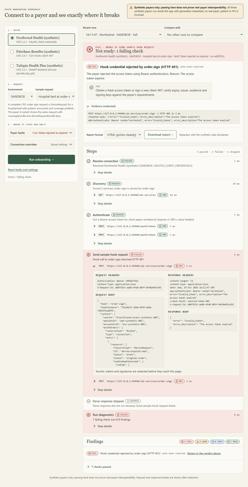
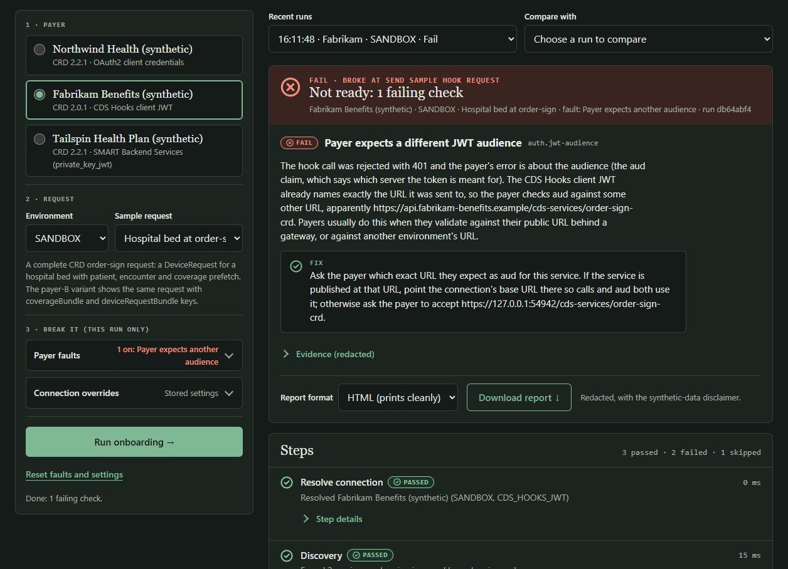
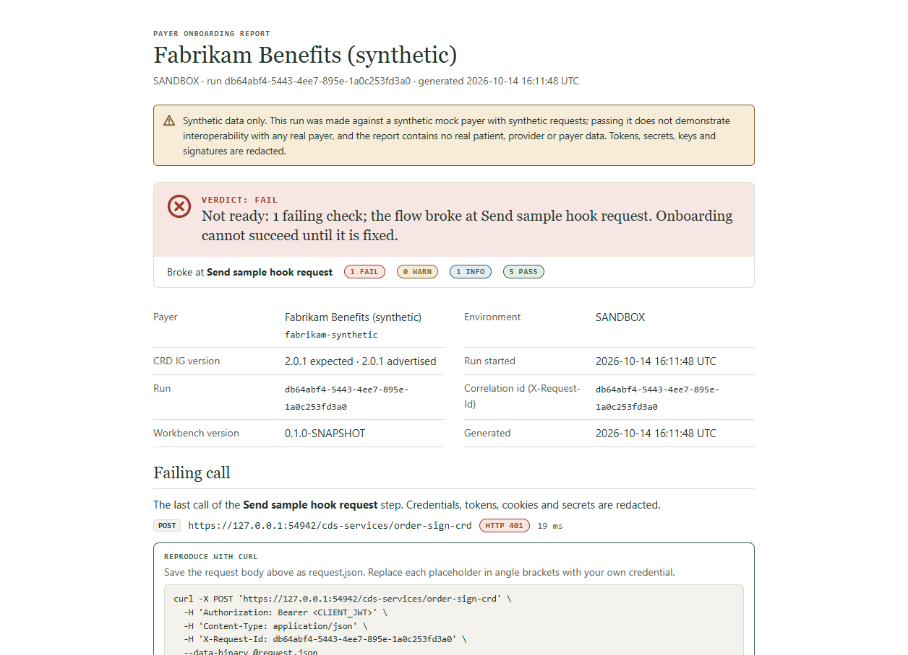
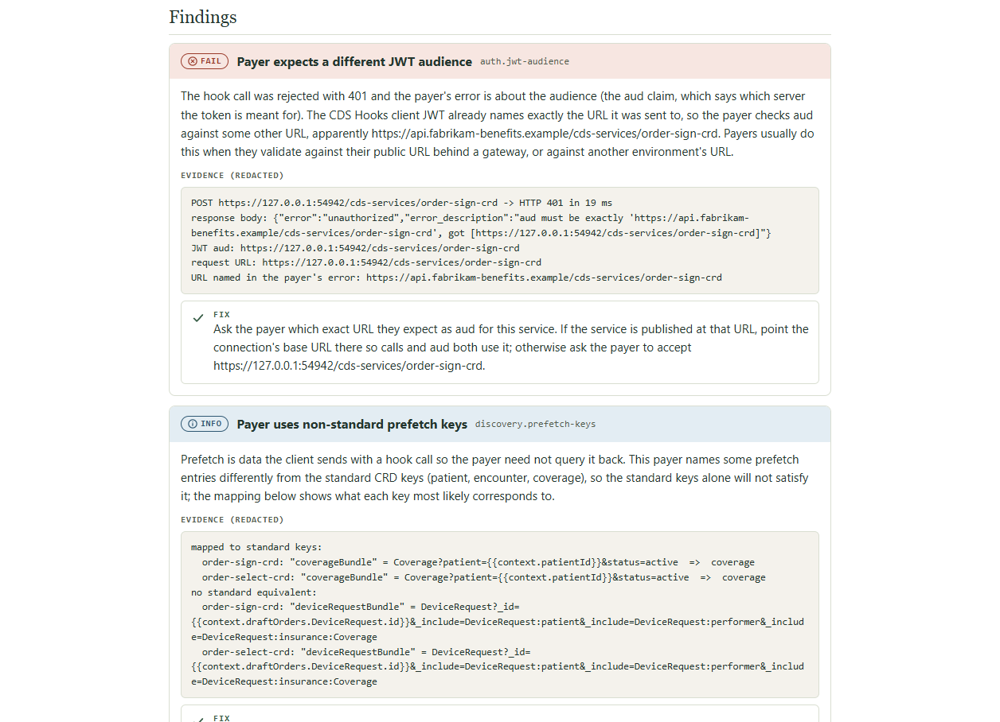
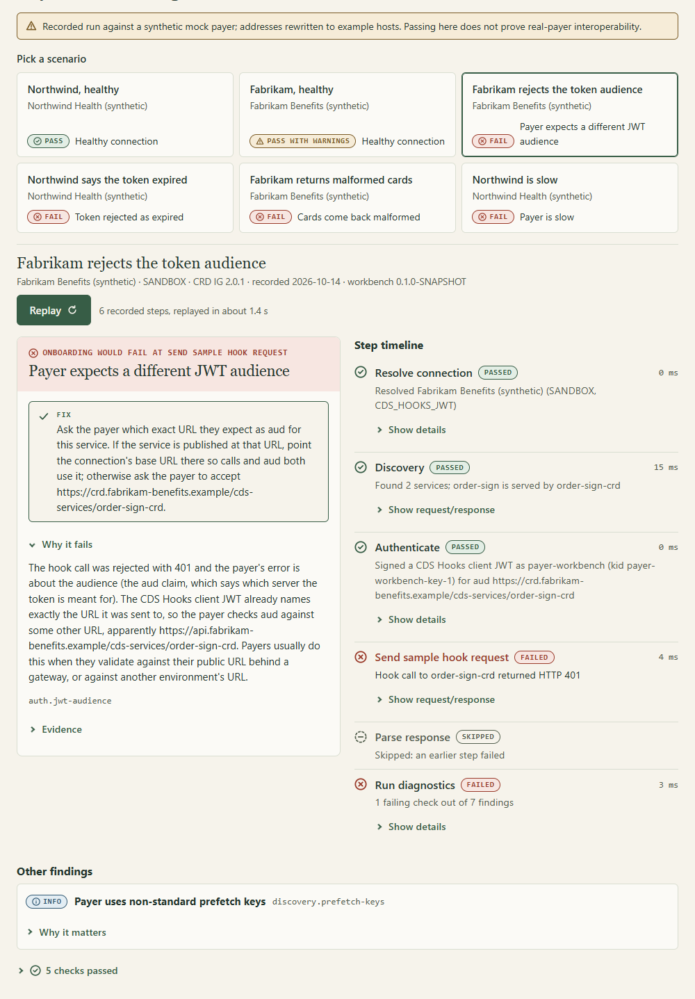

# Payer Onboarding Workbench

Connect to a (synthetic) insurance payer's FHIR CRD / CDS Hooks endpoint, inspect its discovery response, run sample requests, and get a plain-language diagnostic report when something goes wrong.

Built on [fhir-crd-router](https://github.com/dflippojr/fhir-crd-router), which stays independently usable; this workbench is an optional consumer of it.

**Status:** v1 is done. The onboarding flow (API and browser UI), the three mock payers, the diagnostic checks, the sample library, report export, the scripted demo and the replay bundle are merged, and the replay is live on [dflippojr.dev](https://dflippojr.dev/). Later work is tracked in [GitHub issues](https://github.com/dflippojr/payer-onboarding-workbench/issues).

All data is synthetic. No real payers, patients, or PHI. A passing run against the mock payers does not establish interoperability with any real payer.

## Develop

Requires JDK 21. Maven is not needed; use the wrapper.

fhir-crd-router is not on Maven Central yet, so install it into your local Maven repository first. The script clones the pinned commit into `.deps/` (gitignored) and runs its build:

```sh
./scripts/install-crd-router.sh        # macOS, Linux, Git Bash
```

```powershell
.\scripts\install-crd-router.ps1       # Windows PowerShell
```

Build and run the tests:

```sh
./mvnw verify
```

Run the app (serves on http://localhost:8080 by default, listening on loopback only because the API has no authentication; `--server.address` changes that). Install the sibling modules once, then run `workbench-app` on its own; adding `-am` to `spring-boot:run` fails on the parent pom, which has no main class:

```sh
./mvnw install -DskipTests
./mvnw -pl workbench-app spring-boot:run
./mvnw -pl workbench-app spring-boot:run -Dspring-boot.run.arguments=--server.port=9090   # another port
```

CI runs two GitHub Actions workflows on pushes and pull requests:

- `.github/workflows/ci.yml` installs fhir-crd-router, runs `./mvnw -B verify`, then the [demo tour](#demo), the [UI journeys](#ui-interaction-tests), the [replay export](#embed-on-a-website), the leak scanner's self-test (`replay/test/leaks.test.mjs`), the bundle check and the Node regression suites, and uploads `demo-output/` and `site-dist/` as build artifacts. Beside it, the `crd-reference` job runs the workbench against the [HL7 Da Vinci CRD reference server](#run-against-your-own-endpoint), an implementation this project didn't write, and checks each verdict against what CDS Hooks 2.0 and CRD say the server's answers mean (`scripts/reference-runs.mjs`). Its `gate-guard` job calls the shared [gate guard](https://github.com/dflippojr/.github#gate-guard), pinned by full SHA, which fails a pull request that deletes or skips tests, adds retries, or edits workflows or coverage config unless the owner applied `gate-change-approved`. Its `gate` job always reports and fails unless every other job in the file succeeded. The default-branch ruleset requires `gate` and `gate-guard`, both from GitHub Actions. The required `gate-guard` is the check run that `.github/workflows/gate-guard-target.yml` posts from `main` under `pull_request_target`, so a pull request can't rewrite its own judge (ci.yml's `gate-guard` job runs from the pull request's head and is only an early signal). It checks out no pull request code, and it counts the owner's label only when it was applied after the newest push. `npm run ci:local` runs the same steps in the same order on your machine (JDK 21 on `JAVA_HOME`, Docker running for `crd-reference`; Git Bash on Windows) and stops the UI instance even when a step fails.
- `.github/workflows/sonar.yml` runs `verify` with JaCoCo coverage and the SonarCloud scanner, and fails when the SonarCloud quality gate fails. It runs on pushes to `main` and on pull requests from branches in this repository (forks get no secrets, so it skips them). A newer push cancels an older PR run; runs on `main` are never cancelled. The organization and project keys are in the parent `pom.xml`.

`verify` also fails when a module's JaCoCo line coverage drops below its floor, the `jacoco.line.floor` property in that module's `pom.xml`. Each floor started at the measured coverage minus 1 point. Raise a floor when coverage rises; never lower one.

Dependabot (`.github/dependabot.yml`) checks Maven dependencies and GitHub Actions weekly and opens at most 3 pull requests per ecosystem, labeled `dependencies`. The root Maven reactor includes all five module POMs and the Maven wrapper; GitHub Actions updates cover `.github/workflows/`. Nothing auto-merges: CI decides whether each update is safe and the owner merges. Major Spring Boot bumps are ignored and handled as deliberate issues. The `fhir-crd-router` pin (`COMMIT=` in `scripts/install-crd-router.sh`) is invisible to Dependabot and stays a manual bump. So are the CRD reference server's two commits in `scripts/crd-reference-server.env`; its comment says how to bump them.

Same-repository Dependabot PRs run SonarCloud using a repository **Dependabot** secret named `SONAR_TOKEN`. In GitHub Settings → Secrets and variables → Dependabot → New repository secret, the owner must save an authorized analysis token under that exact name. Ordinary PRs and pushes use the existing Actions secret with the same name; Actions secrets are unavailable to Dependabot-triggered runs ([GitHub documentation](https://docs.github.com/en/code-security/reference/supply-chain-security/troubleshoot-dependabot/dependabot-on-actions)). If the token is unavailable, the workflow skips the scanner and reports a notice and job summary explicitly stating that no analysis was published and the quality gate was not evaluated. The separate CI workflow still runs the tests. Once the Dependabot secret and workflow are in place on `main`, trigger a new Dependabot PR update and verify that **Build, test and analyze** ran and SonarCloud published analysis for that PR's head commit. A notice-only run does not satisfy that verification.

Modules:

| Module | Purpose |
|--------|---------|
| `workbench-core` | Shared contracts and `Redactor`. Pure Java, no Spring. |
| `mock-payers` | Three embedded synthetic CDS Hooks payers. |
| `diagnostics` | Diagnostic checks and the engine that runs them. |
| `samples` | Synthetic request payloads. |
| `workbench-app` | Spring Boot app: REST API and static UI. |

Design decisions and how to override them: [DECISIONS.md](DECISIONS.md).

## UI interaction tests

Use the [UI testing contract](docs/ui-testing.md) for the disposable synthetic instance, device/theme journeys and cleanup. After building the jar with Maven, run `npm ci --ignore-scripts`, `node node_modules/@playwright/test/cli.js install chromium webkit`, `npm run test:ui-instance` and `npm run test:ui`. The browser tests start a fresh owned loopback instance for every test and run with one worker. Start an exploratory instance with `node scripts/ui-instance.mjs start`; stop it with `node scripts/ui-instance.mjs stop`.

To check a change in the running app (launch, doctor, drive the main path, evidence, cleanup), use the [verify skill](.claude/skills/verify/SKILL.md): `npm run verify`.

## Onboarding flow

`workbench-app` walks you through connecting to a payer and shows exactly where it breaks. Start it and open http://localhost:8080:

```sh
./mvnw install -DskipTests                  # once, so the app's sibling modules are in your local repository
./mvnw -pl workbench-app spring-boot:run
```



On startup the app launches all three mock payers in-process on loopback ephemeral ports and seeds a `SANDBOX` `ConnectionRecord` for each in a directory-core `FileBasedConnectionStore` under a temp directory (owner-only where the file system supports POSIX permissions, and deleted on shutdown). Credentials (Northwind's client secret, Fabrikam's and Tailspin's separate RSA signing keys) are generated at startup and held only in memory; they are never written to disk, logged or returned by the API.

A run records these steps, each with its status, latency and redacted HTTP exchanges. The first failing step stops the run; the rest are marked skipped, and diagnostics run on whatever was observed.

1. **Resolve connection**: look up the record for the payer and environment, then apply any edits.
2. **Discovery**: `GET {baseUrl}/cds-services`, then find the service for the sample's hook.
3. **Authenticate**: an OAuth2 client-credentials token (Northwind), a signed CDS Hooks client JWT (Fabrikam), or SMART Backend Services `private_key_jwt` (Tailspin).
4. **Send the sample hook request**, with the prefetch keys the payer's discovery asks for.
5. **Parse the response** with the fhir-crd-router client types (cards, system actions, coverage information).
6. **Run diagnostics** (`DiagnosticEngine`, with the sample's hook as the required hook).

Discovery and hook calls go through the router's `CdsHooksClient`, which owns authentication, token caching, retries, timeouts and response parsing. Discovery uses an unauthenticated copy of the connection because all three synthetic payers advertise public discovery. The SDK's TOKEN and HOOK exchange events populate the separate Authenticate and Hook request steps; an OAuth2 401 shows both hook attempts and the token refresh. Diagnostics evaluate the final hook outcome once. For the JWT payer, a transport observer retains only the claims of the JWT the SDK actually sends. Token event bodies contain only `token_type`, `expires_in` and `scope`; token failures use the SDK's sanitized typed error metadata.

The UI is one page. On desktop the setup sits in a 380 px column beside the results, so **Run onboarding** and the answer share the first screen; below 960 px the two stack. The setup column has the payer picker, the environment and sample request, and two drawers for one run: **Payer faults** and **Connection overrides** (base URL suffix, `igVersion`, client id; never a secret). While closed, each drawer's summary says what is on ("1 on: Discovery is down", "Stored settings").

The results lead with the verdict. Before the first run they list the six steps a run walks. While a run is in flight they say what is running, with an indeterminate bar (static under reduced motion) and the six steps pending, and the previous run is hidden. When it ends, the verdict card gives Pass, or where the flow broke, with the first failing check's explanation, **Fix** and evidence, and the **Download report** control (HTML, Markdown or JSON). A compact step timeline follows: one row per step, with skipped steps folded into one row that names the cause, and each HTTP exchange on one line (method, path, status, ms) that opens into request and response side by side. Then come findings grouped by severity, with passing checks collapsed. Status is always an icon plus a word, never colour alone. Focus moves to the results heading when a run finishes.

The page follows `prefers-color-scheme`, has no horizontal scroll from 320 to 2560 px, keeps touch targets at least 44 px and is keyboard navigable. It is plain HTML, CSS and JS under `workbench-app/src/main/resources/static`, with no build step.

### API

| Method and path | Does |
|---|---|
| `GET /api/payers` | The synthetic payers, their stored connections (redacted), editable settings and fault ids. |
| `GET /api/features` | What this deployment allows (`customEndpoints`). |
| `GET /api/samples` | Sample request metadata. |
| `POST /api/runs` | Runs the steps and returns an `OnboardingRun`. Body: `payerId`, `environment` (default `SANDBOX`), `sampleId`, optional `faults` (fault ids), `slowResponseDelayMs`, and `connection` edits (`baseUrlSuffix`, `igVersion`, `clientId`). `baseUrlSuffix` can only add path segments, such as `/r4` or `/`: a suffix that doesn't start with `/` or contains `@`, `?`, `#`, a backslash, whitespace or a control character is refused with 400 and nothing is sent. `slowResponseDelayMs` must be between 0 and `request-timeout` plus 1 s (16000 by default); a negative or longer delay is refused with 400 before any run starts (audit reason `invalid_slow_response_delay`). Runs against one synthetic payer take turns, because its faults are shared: a run waits for the payer at most `request-timeout`, then is refused with 409 "another run against <payer> is in progress", and no run is started or remembered (audit reason `payer_busy`). With custom endpoints enabled, `customEndpoint` replaces `payerId` (see below). |
| `GET /api/runs` | Newest-saved-first summaries of retained runs: identifiers, first-step timestamp (null without steps), verdict and severity counts only. |
| `GET /api/runs/{id}` | A recent run (the last 200 are kept in memory). |
| `GET /api/runs/{id}/report?format=md\|html\|json` | A shareable diagnostic report of a recent run (default `html`). `400` for another format, `404` for an unknown run. |

Every request, to the API, `/actuator/**` and the UI alike, must name the workbench in `Host` as `localhost`, `127.0.0.1` or `[::1]` (any port, any case), or as the `--server.address` literal when that is a specific address rather than `0.0.0.0` or `::`. Anything else gets `403` with a problem detail naming `workbench.allowed-hosts`, before any other filter runs: nothing is started, stored or audited. Listening on loopback keeps other machines out but not a web page the user visits: with DNS rebinding the page's own name resolves to `127.0.0.1`, its same-origin requests reach the workbench with that name in `Host`, and the browser lets the page read the answers. If you deliberately serve the workbench under another name with `--server.address`, add it with `--workbench.allowed-hosts=name1,name2`. Each entry is a bare host name, an IPv4 address or an `[IPv6]` address, optionally with `:port` (ignored). A scheme, path, user info, wildcard or empty entry stops the workbench from starting, so `http://name` can't quietly allow the name `http`. An IPv6 address, in this setting or `--server.address`, is compared in the compressed form a browser sends (`2001:db8:0:0::5` matches `Host: [2001:db8::5]`). The single value `*` turns the check off and brings DNS rebinding back.

The live UI's **Recent runs** selector reloads history after a browser refresh and after each run. Reopening retrieves the existing timeline, findings and report without executing a run or changing form settings. History is process-local memory, bounded by `workbench.max-runs` (default 200), with the oldest insertion evicted first. A server restart clears all runs and reports; browser refresh does not.

Once a run is on screen, **Compare with** picks another retained run and shows a **Changes since run** section: tiles for the verdict and broke-at step before and after with a direction word, the steps whose status changed on one line, a **Checks that changed** table (newly failing or worse, fixed or better) with the unchanged checks named, and a collapsed **Only in one run** group. **Stop comparing** clears it. Checks are matched by `checkId` using each run's most severe finding. A check that only one run reported, such as checks skipped after a Discovery failure, is listed under **Only in one run** with the run that reported it and its result, and is never ranked as better, worse or unchanged. The comparison runs in the browser from two `GET /api/runs/{id}` reads, and is not part of reports or the replay viewer.

```sh
curl -s localhost:8080/api/runs -H 'Content-Type: application/json' \
  -d '{"payerId":"northwind-synthetic","sampleId":"order-sign-hospital-bed","faults":["expired-token-401"]}'
```

Faults apply to one run only; runs against the same payer are serialized so faults never leak between them.

### Run against your own endpoint

Off by default. The workbench otherwise only talks to its own synthetic payers; with custom endpoints on it forwards requests to a URL the caller supplies, so a deployed copy would be a request-forwarding service. Turn it on only for a copy you run yourself, on your own machine:

```sh
./mvnw -pl workbench-app spring-boot:run -Dspring-boot.run.arguments=--workbench.custom-endpoints.enabled=true
```

The UI then offers **Your own endpoint** in the payer picker, and `POST /api/runs` accepts `customEndpoint` instead of `payerId`. The run gets the same step timeline, findings and redacted report; its payer id is `custom-endpoint`. Connection edits (`baseUrlSuffix`, `igVersion`, `clientId`) apply to the supplied endpoint for this run only, overriding its values; blank edits keep the supplied values. The suffix uses the same path-only validation as synthetic runs and cannot add user info, a query or a fragment. Payer faults only apply to synthetic payers: the UI hides them for custom runs, and the API rejects custom requests with faults.

```sh
# The HL7 CRD reference server (bash scripts/crd-reference-server.sh start; CI's crd-reference job runs it):
curl -s localhost:8080/api/runs -H 'Content-Type: application/json' -d '{
  "sampleId": "order-sign-hospital-bed",
  "customEndpoint": {"baseUrl": "http://127.0.0.1:18090/r4", "authType": "NONE"}
}'
```

`customEndpoint` takes `baseUrl`, `authType` (`NONE`, `OAUTH2_CLIENT_CREDENTIALS`, `CDS_HOOKS_JWT` or `OAUTH2_PRIVATE_KEY_JWT` (SMART Backend Services)), `clientId`, `tokenEndpoint` (client credentials or SMART), `keyId` (CDS Hooks JWT or SMART), optional `igVersion` (default `2.0.1`) and `credential` (the client secret, or a PKCS#8 private key PEM).

With `authType: NONE` the hook call is sent without credentials and Authenticate passes as "No authentication configured", so a healthy payer that needs no auth, such as the reference server above, gets `PASS`. If the payer does want credentials, the run fails at Hook request and `auth.hook-rejected` says the request carried none.

For SMART Backend Services, supply all four authentication fields. The SDK chooses RS384 for RSA keys and ES384 for EC keys; register the matching public key with your local payer. This placeholder-only request illustrates the API shape (replace the placeholders before use):

```json
{
  "sampleId": "order-sign-hospital-bed",
  "customEndpoint": {
    "baseUrl": "http://127.0.0.1:18090",
    "authType": "OAUTH2_PRIVATE_KEY_JWT",
    "clientId": "<registered-client-id>",
    "tokenEndpoint": "http://127.0.0.1:18090/oauth/token",
    "keyId": "<registered-key-id>",
    "igVersion": "2.2.1",
    "credential": "<PKCS#8 private key PEM>"
  }
}
```

Keys stay in memory for one run, including rejected authentication. Reports show only the existing allowed assertion claims, never the signed assertion or signature. Custom endpoints remain disabled by default and intended only for your own local workbench.

- **Destinations.** `https` to public hosts, or `http` to `localhost`, `127.0.0.1` or `[::1]`. Private, loopback (for other hosts), link-local, unique-local, carrier-grade NAT and cloud-metadata addresses are refused with a message saying why, for the base URL and the token endpoint. A name that merely resolves to loopback doesn't get plain `http`. URLs with user info, a query or a fragment are refused, and redirects are never followed. Plain `http` to loopback is for a caller on this machine. A web page that rebinds its own name to `127.0.0.1` would turn it into a scanner of your loopback ports, so a request whose `Host` is not one of the workbench's own names is refused with `403` before any run starts (see [API](#api)).
- **DNS.** A host is resolved when the run starts and every request is checked against that answer; a changed answer aborts the call. The JDK HTTP client does its own lookup when it connects, so a rebind in that instant is narrowed, not impossible. That is another reason to keep this off on anything shared.
- **Credentials.** Accepted in the request body only, held in memory for that one run, then dropped. They are never stored, returned by `GET /api/runs/{id}`, logged, or put in a report; recorded exchanges go through `Redactor` as before, and so does whatever a payer echoes back into a card, an error or a finding (#211). That masking goes by pattern, not by value: an echo is masked when it keeps its scheme (`Bearer …`, `Basic …`, `Token …`, `DPoP …`), its secret-named field or form key, its PEM armor, or its place in a JWK. A payer that quotes the bare token or secret with none of these (`invalid token "…"`, `Bearer: …`) is not caught. `CustomEndpointTest` and `RunReportTest` plant a credential and look for it in the run, all three report formats, the log and the actuator endpoints.
- **Scope.** Passing against your own endpoint still only shows what the workbench observed in that run. Nothing is persisted, the replay bundle stays synthetic-only, and the workbench never retries, crawls or scans.

### Diagnostic reports

`GET /api/runs/{id}/report` turns a run into a report you can attach to a ticket or send to a payer. Every format covers the same ground: the verdict (`PASS`, `PASS_WITH_WARNINGS` or `FAIL`, and the step where the flow broke), the payer, environment and CRD IG version (expected by the connection and advertised by the payer), the run's correlation id (see [Observability](#observability)), the step timeline with each HTTP exchange, findings by severity (most severe first) with explanation, redacted evidence and fix, when it was generated and by which workbench version, and the synthetic-data / no-interoperability disclaimer.

- `html` is one self-contained file (inline CSS, no scripts or external assets). It opens with the verdict (icon and word, the step where the flow broke, counts by severity), then the facts with times in UTC to the second, the failing call, the timeline and the findings. The full ISO time stays in each `<time datetime>` attribute. On screen it uses the workbench's tokens and follows a dark preference. Print is always light, keeps headings with the block after them, keeps small blocks (facts, steps, Fix, the curl command, the footer) whole, and lets long bodies and findings flow across pages, so no page is left half blank.
- `md` is for pasting into an issue or a wiki.
- `json` is the same report as data, including each step's full (redacted) details and full ISO timestamps.

A `FAIL` report in `html` and `md` also has a **Failing call** section, between the verdict and facts and the timeline, so a payer engineer can see and reproduce the failure from the report alone. It shows one exchange: the last call of the step the flow broke at, or, when that step made no call or the flow completed and a check failed (`perf.latency`, `response.coverage-information`), the last hook request. There is no section when neither has a call, as with `connection.record`. The section gives the method, URL, status and latency, a `curl` command for the call (first in `html`), and the redacted request and response headers and bodies (JSON pretty-printed; each body capped at 16 KiB with a note that the JSON report has the full body, or its first 64 Ki characters as the run keeps them) or the transport error. In `html` the request and response sit side by side on screen and stack in print. The command keeps the non-secret request headers, drops credential headers, `Content-Length` and `Host`, sends `Authorization: Bearer <ACCESS_TOKEN>` (`<CLIENT_JWT>` for CDS Hooks JWT, `Basic <BASE64_CLIENT_ID_AND_SECRET>` for a Basic token request) where one was sent, reads the body shown above from `request.json` (`request-body.txt` for a non-JSON body) with `--data-binary`, and replaces anything the redactor masked with `<SECRET>`, so it never carries a credential or its redacted form. The `json` format is unchanged.

Redaction happens where data enters the run, and again when the report is built. Exchanges are redacted when they are recorded; a step's summary and details when the step is (`StepResult`); a finding's title, explanation, evidence and fix when it is created (`Finding`). In details and reports every string goes through `Redactor`, and any field named like a secret (`client_secret`, `access_token`, `Authorization`, `privateKey` and similar) is masked (`Redactor.redactTree`). String map keys are redacted too; arrays, `Optional`s and other collections are walked; a value of any other type, such as a parsed JSON tree, is kept only as its redacted string form. So `POST /api/runs`, `GET /api/runs/{id}` and the UI show what the reports show, even when a payer echoes the credentials it received into a card or an error. `Redactor` masks the same field names in recorded JSON bodies, including number, boolean, object and array values (a private JWK under `private_key` is masked whole) and JSON quoted inside a JSON string (also when that JSON is cut off before the string ends), and the private members of a JWK (`d`, `p`, `q`, `dp`, `dq`, `qi`, `oth` and `k`) in any JSON object with a `kty` member: a bare JWK, each key of a JWKS, also in JSON quoted inside a JSON string (a field named `d` in any other object is kept, except in malformed text that would take more than linear time to read, where every such name is masked). It masks a PEM block or PGP private key block, also one cut off before its footer, and a `Bearer`, `Basic`, `Token` or `DPoP` credential, URL-encoded or not (also after `Bearer%20` or `Bearer+`), through to the next whitespace, quote, comma, semicolon or backslash; a JSON escape of a token character counts as that character (`\/`, or `\u002B` and the other `\u` escapes of letters, digits and `-._~+/=`), so a token quoted by a serializer that escapes some of its characters (PHP escapes `/`, .NET's `System.Text.Json` escapes `+`) is masked whole. One short all-letter word after the scheme is kept as prose (`Missing bearer token`, `Basic authentication is required`, `Token expired`, also `token endpoint:` with its colon), unless it is a `Basic` token that decodes to a `user:pass` pair, with or without the period that ends a sentence. Anything longer is masked, so ordinary card text such as `Basic 80/20 plan` or `Basic Plan-A coverage` shows as `Basic [REDACTED] plan` in the live run and the reports alike; the rule errs toward masking. A form secret (`client_secret=...`) is masked through any backslash in it, stopping only at one that starts a JSON escape such as `\n` or `\"`. `RedactorPropertyTest` (jqwik) checks these rules as a class: it generates random tokens, Basic `user:pass` pairs, colon-split bearer tokens, numeric secrets and PEM private keys, raw or URL-encoded, places them in headers, bodies and query strings, with or without the text quoted inside a JSON string (also by a serializer that escapes `/` as `\/`, or `+` and `/` as `\u` escapes), and fails if any 8 characters of a secret survive, through `Redactor` and through every text field of `StepResult` and `Finding`, found by reflection. `replay/test/leaks.test.mjs` runs the same seeded generator against the replay leak scanner. The failing-call section is built from those redacted details and redacted once more after pretty-printing. `RunReportTest` plants a bearer token, a client secret, a JWT signature and a PEM private key in a run's step details, findings, and the failing exchange's request and response headers and bodies, and checks that none of them reach any format or the curl command.

```sh
curl -s "localhost:8080/api/runs/$RUN_ID/report?format=md" -o report.md
```



### What each fault and misconfiguration fails

The integration tests (`OnboardingFlowTest`) hold the app to this table on all three payers.

| Fault or edit | Breaks at | FAIL `checkId` |
|---|---|---|
| none (healthy run) | nothing | none |
| `slow-response` | (steps pass; only the hook call is slow) | `perf.latency` |
| `expired-token-401` | hook request | `auth.hook-rejected` (payer expiry reason) |
| `rate-limited-429` | hook request | `perf.rate-limit` (`Retry-After: 30`, backoff advice) |
| `wrong-audience-reject`, Fabrikam | hook request | `auth.jwt-audience` |
| `wrong-audience-reject`, Northwind | hook request | `auth.hook-rejected` |
| `wrong-audience-reject`, Tailspin | authenticate | `auth.client-assertion` (expected and sent `aud`) |
| `coverage-info-incomplete` (all payers, `order-sign`) | diagnostics | `response.coverage-information` |
| `malformed-card` | parse response | `response.schema` |
| `discovery-500` | discovery | `discovery.reachable` |
| `prefetch-missing-400`, with sample `order-sign-missing-prefetch` | hook request | `response.schema` |
| `untrusted-certificate` | discovery | `tls.handshake` (untrusted CA) |
| `expired-certificate` | discovery | `tls.handshake` (expired certificate) |
| `hostname-mismatch` | discovery | `tls.handshake` (different host) |
| base URL suffix `/r4` | discovery | `discovery.reachable` |
| `igVersion` `1.0.0` | (steps pass) | `ig.version` |
| wrong client id, Northwind | authenticate | `auth.token` |
| wrong client id, Tailspin | authenticate | `auth.token`, `auth.client-assertion` |
| wrong client id, Fabrikam | hook request | `response.schema` |
| environment `PRODUCTION` (no record) | resolve connection | `connection.record` |

`response.coverage-information` validates every coverage-information extension in system actions and card suggestions using the router's Da Vinci CRD 2.2.1 validator. Evidence identifies the resource, extension location, and each violation's path and message. ERROR violations produce FAIL, WARNING violations produce WARN, and conformant content produces PASS. Healthy Northwind and Tailspin pass; healthy Fabrikam warns about its legacy `identifier` name without failing. With no coverage information, the check adds no finding.

Findings that come from the app rather than the diagnostics engine: `connection.record`, reported when no connection record exists, since nothing is sent, `run.response-too-large`, reported when a payer response ran past `workbench.max-response-bytes` or held more than `workbench.max-response-json-values`, and `run.too-many-cards`, reported when a hook response holds more than 1,000 cards. `Redactor` masks a bearer JWT whole in the recorded exchange, so for `auth.jwt-audience` the app records the non-secret claims of the CDS Hooks client JWT the SDK signs (`iss`, `aud`, `exp`, `iat`, `jti`, `kid`, never the token or its signature) with each hook call, and the engine compares `aud` with the service URL. When `aud` already is the service URL but the payer's 401 is about the audience, as with Fabrikam's `wrong-audience-reject`, the finding says the payer expects another URL and quotes the one it names. Tailspin records only `iss`, `sub`, `aud`, `exp`, `iat`, `jti`, and `kid` from the actual assertion signed by `JwtSigner.clientAssertion`; it never stores the assertion, encoded parts, signature or private key. `auth.client-assertion` passes when the token endpoint accepts it, and explains identity, audience, lifetime and replay rejections using the recorded claims and payer error description. Northwind checks the audience of its own access token, which the workbench cannot inspect, so `auth.hook-rejected` explains that 401 from the payer's `WWW-Authenticate` header and JSON error body. Fabrikam client-id rejections use the same check. It names the rejected credential, quotes the payer's reason, and recommends a fix for RFC 6750 `invalid_token`, `insufficient_scope` or `invalid_request`. Generic response-schema failures are suppressed for explained authentication and throttling errors. An expired credential alone is not clock skew; `auth.clock-skew` requires a measured difference or an explicit clock error.

Settings (`workbench.*` in `application.properties` or on the command line): `slow-response-delay` (default `11s`, past the 10 s budget), `latency-warn` (`5s`), `latency-fail` (`10s`), `request-timeout` (`15s`), `max-runs` (`200`), `max-response-bytes` (`4194304`, 4 MiB), `max-stored-run-bytes` (`33554432`, 32 MiB), `max-response-json-values` (`100000`), `max-concurrent-runs` (`4`). `request-timeout` and `max-runs` must be positive, and `slow-response-delay`, `latency-warn` and `latency-fail` must not be negative: the app refuses to start and names the setting when one is out of bounds, rather than failing each run later. `request-timeout` covers each whole payer call, body included: the JDK's own timeout stops once the response headers arrive, so a payer that sends headers and then stalls would otherwise hold the run for good. Past the timeout the call is cancelled, its partial body dropped, and the step fails as a call that got no response. The workbench stops reading any payer response body at `max-response-bytes`: the step fails with "the response exceeded the 4 MiB limit", the run records the status and headers, and the `run.response-too-large` finding names the limit. Bytes alone do not bound what parsing builds, since 4 MiB of `{}` is 1.4 million objects, so a body that arrived in full is also counted as a stream of JSON tokens before anything parses it. A body with more than `max-response-json-values` values (objects, arrays, strings, numbers, booleans and nulls) fails the same way: "the response holds more than 100000 JSON values", and the run keeps only its first 8 Ki characters. Within those limits, a step's details show at most 100 cards, coverage-information entries and discovered services, and at most 20 prefetch keys per service and `docNeeded` values per entry, followed by a count of the rest (`cardsNotShown`, `coverageInformationNotShown`, `servicesNotShown`, `prefetchKeysNotShown`, `docNeededNotShown`). A token response's `scope` keeps its first 20 scopes, and the `auth.token` evidence counts the rest ("and N more not shown"). Each payer-supplied string in a step's details or a token response (card summary, indicator and source label, service id, hook and prefetch key, coverage fields, `token_type`, each scope, `error` and `error_description`) is cut to 1,024 characters followed by `…`, each evidence line a check quotes to 1,024, and each text field of a finding to 8 Ki characters, so a few huge strings cannot make a large run. A selected service id longer than 1,024 characters fails discovery, since the workbench would have to put it in the hook URL. The parse summary names the first 5 cards that lack fields, a finding's evidence lists at most 20 problems, and a hook response with more than 1,000 cards fails the parse step without reading each card. The diagnostics read each body in full, up to those limits, but a remembered run keeps only the first 64 Ki characters of each request and response body, followed by `[kept the first 65536 of N characters]`. Past `max-stored-run-bytes` of remembered runs, measured as JSON, the oldest are forgotten even before there are `max-runs` of them; the newest is always kept. Together these bound the memory of one run however many runs `max-runs` keeps. A run in flight can still hold a few full bodies while it parses them, so at most `max-concurrent-runs` custom-endpoint runs run at once; one more is refused with HTTP 503, a `Retry-After: 5` header and a problem detail naming the setting, rather than queued. Runs against the synthetic payers are not counted: their responses are the workbench's own, and runs against one payer already take turns, each waiting at most `request-timeout` for its turn. The audit journal settings are listed under *Durable audit journal*.

## Audit review (offline)

Run creation, actual credential resolution, run/history reads and report rendering emit one
JSON object after the `audit ` log message marker. Each HTTP request gets a server-generated
UUID; produced runs keep their existing outbound run ID. Callers are always `anonymous`
with a null actor ID and source `http`, regardless of supplied identity/correlation headers.
`report.rendered` records server rendering, not proof of saving or publishing a report.
A HEAD request to a read route runs the same handler as GET and is audited the same way.
An HTTP 200 `run.completed` can have a diagnostic verdict of `FAIL`.

Capture the existing log destination yourself, for example after building:

```sh
java -jar workbench-app/target/workbench-app-0.1.0-SNAPSHOT.jar > synthetic-capture.log 2>&1
node scripts/audit-reader.mjs synthetic-capture.log --run <server-run-uuid>
node scripts/audit-reader.mjs synthetic-capture.log --action report.rendered --since 2026-10-08T12:00:00Z --until 2026-10-08T13:00:00Z
```

Review a checked-in synthetic fixture without starting the app:

```sh
node scripts/audit-reader.mjs scripts/fixtures/audit-synthetic.jsonl --run 00000000-0000-4000-8000-000000000067
node scripts/audit-reader.mjs scripts/fixtures/audit-synthetic.jsonl --action run.requested
node --test scripts/audit-reader.test.mjs
```

The reader accepts one named capture, ignores unrelated logs, and emits matching events
as JSON lines. UTC `--since`/`--until` boundaries are inclusive, including nanoseconds.
A run filter selects credential/terminal/report events; the initial request event has no
run ID yet, so correlate it using the terminal's request ID in the unfiltered capture.
Malformed audit lines produce a count on stderr and a nonzero exit without echoing contents.
The app's own gap warnings (`Audit event write failed; audit trail has a gap` and `Audit journal
unavailable; durable audit trail is not being written`) are not malformed lines. The reader counts
them on stderr as `Audit gap warnings: N` and still exits 0: the capture is complete, and the gap
is in what the app failed to write.
Review makes no server calls and writes no files. Restrict access to captures using the
OS owner's permissions; the reader provides no additional authentication.

Audit metadata is an allowlist: known catalog IDs, enums, status/reason codes, verdict,
applied override field names and logical credential IDs (opaque per-run IDs for custom
credentials). It excludes credential values, client IDs, URLs, bodies and diagnostic content.
Availability means a credential was found, not that payer authentication succeeded.
Catalogs, static assets and actuator scrapes are outside this trail.
Normal operational logs remain separate and are not audit records.

Logging is best effort. An observable sink failure preserves the API/run behavior, emits
the constant warning `Audit event write failed; audit trail has a gap`, and increments
`workbench.audit.write.failures` (Prometheus: `workbench_audit_write_failures_total`). No
side effect is retried. Missing captures or logger/OS loss can also leave evidence gaps.
Durable storage is opt-in; see the next section. Without it, the only copy is the log
you capture yourself.

### Durable audit journal (#69)

Set `workbench.audit.journal-dir` to an **absolute** directory (for example
`--workbench.audit.journal-dir=/var/lib/workbench-audit`) and every audit event is also appended
to rolling JSON-lines segments there. Stdout logging continues unchanged as the secondary sink.

| Setting | Default | Meaning |
|---|---|---|
| `workbench.audit.journal-dir` | unset (journal off) | Absolute directory outside any source checkout |
| `workbench.audit.retention` | `30d` | Closed segments whose newest event is older than this are deleted; must be positive |
| `workbench.audit.segment-bytes` | `10485760` (10 MiB) | A segment is closed before it would pass this size; must be positive and at most `1073741824` (1 GiB) |
| `workbench.audit.total-bytes` | `104857600` (100 MiB) | When all segments exceed this, the oldest closed ones are deleted first, so the size cap can shorten the 30 days; must be positive |
| `workbench.audit.operator-label` | unset | Optional `[A-Za-z0-9._-]` label written to the manifest to name the deployment |

A zero or negative `retention`, `segment-bytes` or `total-bytes` (a typo such as `-30d` or `0d`)
never turns retention into a full wipe: the journal is left **unavailable**, exactly like a rejected
location below, and no segment or the manifest is read, changed or deleted. A `segment-bytes` above
1 GiB is refused the same way. A leftover segment of any size (even 2 GiB or more) is sealed by
streaming it, so it never stops the application from starting.

- **Location and access.** The directory is created owner-only (mode `0700`, or an ACL for the
  owner on Windows). An existing directory that group/others (or other Windows principals) can access,
  a relative path, a symlink, a path inside a checkout (a `.git` or `pom.xml` above it) or an
  unreadable manifest is **rejected**: the application logs the constant warning
  `Audit journal unavailable; durable audit trail is not being written`, counts it in
  `workbench.audit.write.failures`, sets the gauge `workbench.audit.journal.protected` to `0`
  and keeps running with log-only audit. It never silently counts as a protected journal. Review
  access is the OS owner's file access; there is no web page, endpoint or role.
- **Files.** `audit-000001.jsonl`, `audit-000002.jsonl`, ... plus `manifest.json`, a versioned list
  of closed segments (ID, bytes, event count, first/last UTC time, SHA-256). The open segment is
  not in the manifest until it is closed by size or by the next start. Nothing in the application
  updates or deletes events except retention. Run history stays memory-only (`max-runs`) and is
  independent of the journal.
- **One writer per directory.** An exclusive OS file lock is held for the lifetime of the journal,
  before recovery or retention runs. A competing process or application context falls back to
  logging, emits the constant journal-unavailable warning, increments `workbench.audit.write.failures`
  and reports `workbench.audit.journal.protected=0`. It does not adopt or change the active writer's
  segments or manifest. The empty `.writer.lock` file stays in the directory; do not delete it while
  any writer is running. Context shutdown writes dependent cleanup events, closes the active segment
  without sealing it, then releases ownership. The next successful start seals leftover segments.
- **Retention is a recorded operation.** Expiry deletes whole closed segments and appends one
  `audit.retention` event (`system` `audit-journal`, reason `age`, `size_cap` or `age_and_size_cap`,
  and the expired segment IDs and count, never record contents). It is retention, not evidence of
  immutable storage.
- **Who.** Callers are `anonymous`; system work is `system` with a named actor. The operator label
  only labels the process in the manifest. It does not say who made a request, and no header,
  payer credential or JWT claim is ever used as an actor.
- **Failure.** If a write or a rotation fails (full disk, deleted directory) the run, the API and
  the logging sink carry on, the constant warning `Audit event write failed; audit trail has a gap`
  is logged and `workbench.audit.write.failures` is incremented. The event is lost from the
  journal; that is the documented gap. A failed write closes the segment so the next event starts
  a fresh one. No side effect is retried.
- **Review and verify (offline).**

```sh
node scripts/audit-reader.mjs /var/lib/workbench-audit --run <run-uuid>
node scripts/audit-reader.mjs /var/lib/workbench-audit --action audit.retention
node scripts/audit-reader.mjs /var/lib/workbench-audit --verify
```

  Review accepts a journal directory as well as a log capture and takes the same filters. It reads each segment
  line by line at any size; a segment that exists but cannot be read fails the review with a nonzero exit, and
  only a missing segment is skipped. `--verify`
  prints one `{"segment":...,"status":...}` line per segment: `ok`, `missing`, `checksum_mismatch`,
  `truncated`, `malformed`, `event_count_mismatch`, or `unsealed` (a segment the manifest does not
  list yet, such as the one being written or left by a crash; not a failure). It exits nonzero on any
  problem and never prints event content. Checksums detect accidental corruption, truncation and
  missing files. They do **not** stop anyone with write access from changing a segment and the
  manifest together; the machine owner is trusted, and there is no signing or WORM storage.
- **Backup and restore.** Copy the directory (stop the app or accept an unsealed last segment).
  A restored copy reads the same events with the same IDs and timestamps; nothing is rewritten.
  **Restoring an older backup rolls the trail back** to that point: events after the backup are
  gone, and there is no separate journal that survives a restore. On the next start any leftover
  segment is sealed and a new segment begins, so processes are never silently merged.
- The journal records only the allowlisted metadata above. It never holds credentials, request or
  response bodies, FHIR/financial content or reports, and it cannot attest that a report was saved
  or a site published. Synthetic marker tests cover segments, reader output and the manifest.

Restoring an older log capture rolls the visible trail back too. The machine owner is trusted;
this is not tamper-proof storage or a compliance journal.

### Fault changes and system operations

The same marker and reader also carry admin and lifecycle events (#68):

| Action | Actor / source | Meaning |
|---|---|---|
| `fault.enable`, `fault.disable`, `fault.delay_set`, `fault.clear`, `fault.change` | `anonymous` / `http` | A `POST`, `PUT` or `DELETE` to `/admin/faults[/{id}]` on a synthetic payer, with or without `X-Request-Id`. Outcome `success` or `rejected`. Metadata has the payer ID, the known fault ID (null when the ID was unknown), and `faults`: enabled fault IDs before and after, `slowResponseDelayMs` before and after, and `changed` (false for a no-op or a rejected attempt). Rejected attempts carry fixed `reasonCode`s: `unknown_fault`, `invalid_delay`, `method_not_allowed`. Read-only `GET` creates no event. |
| `fault.changed` | `unknown` / `programmatic` | `FaultSettings` was changed directly by code outside the admin endpoint and outside a run. It is never reported as an owner operation. |
| `fault.run_setup`, `fault.run_reset` | the run's actor | One snapshot when a run applies its faults and one when its `finally` clears them, with the run ID and request ID. The reset shows the state that was actually restored. A setup that could not be applied is `rejected` with `setup_failed` and changed nothing. |
| `warmup.started`, `warmup.finished` | `system` `first-run-warmup` / `job` | The background warm-up run and the app's own empty-body self-request, which is recognised by a random in-memory single-use value (never configuration, logged or returned). Any other caller, including one that sends actor, source or the internal header itself, stays `anonymous`. Warm-up still never appears in run history, metrics or replay exports. |
| `startup.configuration`, `payer.started`, `connection.seeded`, `credential.put`, `credential.removed`, `payer.stopped`, `cleanup.attempted`, `cleanup.finished`, `startup.failed` | `system` `application` / `lifecycle` | Startup seeding and shutdown cleanup. Targets are payer IDs and logical connection/credential IDs only; never generated values, JWKS or key contents, paths, URLs, environment, arguments or whole property objects. Configuration records the custom-endpoints boolean, max runs and latency/timeout durations. |

`cleanup.finished` reports what was observed: `success`, `partial` (reason `delete_failed`, with safe `attempted`, `deleted` and `failed` counts) or `failed` (`walk_failed`). It never claims a deletion that failed. Logs cannot guarantee a shutdown event after `SIGKILL`, a crash or power loss, so a missing `cleanup.finished` means the process did not stop cleanly, not that cleanup succeeded.

Standalone mocks started without Spring still emit parseable `audit ` lines for their admin changes through `System.Logger`, and an embedding application can replace the sink with `MockPayer.auditSink`. The standalone admin endpoint remains unauthenticated and cannot identify a person, so its events are `anonymous`; a TLS handshake rejected by a certificate fault happens before HTTP, so it is never an admin event. Demo and replay scripts call the API as anonymous HTTP clients; their local output-file deletion, copying and website publication are outside the server's view.

## Observability

Each run has a correlation id, which is its run id. Payers ask for a request id when you report a failed call, so the workbench sends it as `X-Request-Id` on every discovery, token and hook call, shows it on each recorded request in the timeline, and prints it in all three report formats (the `Correlation id (X-Request-Id)` row, or `correlationId` in JSON). The mock payers echo the header back on the response and log it with the method, path and status, so you can follow one call from the workbench's log to the payer's log:

```text
INFO ... [5dd4e05a-d342-478a-88c3-c65cca71958e] i.g.d.p.app.OnboardingRunner : step runId=5dd4e05a-d342-478a-88c3-c65cca71958e payer=northwind-synthetic step=discovery status=passed ms=221
INFO ... [] i.g.d.payerworkbench.mock.MockPayer : Northwind Health (synthetic): POST /oauth/token -> 200 requestId=5dd4e05a-d342-478a-88c3-c65cca71958e
```

While a run executes, its id is in the logging MDC (`runId`, shown in brackets on every log line, and `payer`). Each step logs one INFO line with the run id, payer, step, status and milliseconds. Request and response bodies are never logged. `OnboardingFlowTest` captures everything each of its tests logs and fails if the `Redactor` patterns would mask anything in it, or if a request or response body shows up.

Spring Boot Actuator exposes `/actuator/health`, `/actuator/info` and `/actuator/prometheus`, and no other endpoint. They share the API's port and so listen on loopback only. If you move them to a port of their own with `management.server.port`, also pass `--management.server.address=127.0.0.1`: that port does not use `server.address` and otherwise listens on every interface. (Spring Boot refuses `management.server.address` without a separate port, so it can't be the default.) A port of its own keeps the `Host` check described under [API](#api), with `management.server.address` as its bind literal. The run metrics are tagged with `payer` and `environment`. No tag carries a run id, URL or anything else with high cardinality.

| Metric | Type | Extra tags |
|---|---|---|
| `workbench.runs` | counter | `verdict` (`PASS`, `PASS_WITH_WARNINGS`, `FAIL`), `broke_at` (step id, or `none`) |
| `workbench.step.duration` | timer | `step`, `status` (`passed`, `failed`, `skipped`) |
| `workbench.payer.request.duration` | timer, one sample per HTTP attempt (a retried call counts twice) | `phase` (`discovery`, `token`, `hook`), `status_class` (`2xx`, `4xx`, `5xx`, `error` when no response arrived) |
| `workbench.findings` | counter | `check`, `severity` |

After one healthy Northwind run and one with `discovery-500` (excerpt):

```sh
$ curl -s localhost:8080/actuator/prometheus | grep workbench_
workbench_findings_total{check="discovery.reachable",environment="SANDBOX",payer="northwind-synthetic",severity="FAIL"} 1.0
workbench_findings_total{check="discovery.reachable",environment="SANDBOX",payer="northwind-synthetic",severity="PASS"} 1.0
workbench_payer_request_duration_seconds_count{environment="SANDBOX",payer="northwind-synthetic",phase="discovery",status_class="2xx"} 1
workbench_payer_request_duration_seconds_count{environment="SANDBOX",payer="northwind-synthetic",phase="discovery",status_class="5xx"} 1
workbench_payer_request_duration_seconds_count{environment="SANDBOX",payer="northwind-synthetic",phase="hook",status_class="2xx"} 1
workbench_runs_total{broke_at="discovery",environment="SANDBOX",payer="northwind-synthetic",verdict="FAIL"} 1.0
workbench_runs_total{broke_at="none",environment="SANDBOX",payer="northwind-synthetic",verdict="PASS"} 1.0
workbench_step_duration_seconds_count{environment="SANDBOX",payer="northwind-synthetic",status="failed",step="discovery"} 1
workbench_step_duration_seconds_count{environment="SANDBOX",payer="northwind-synthetic",status="passed",step="discovery"} 1
workbench_step_duration_seconds_count{environment="SANDBOX",payer="northwind-synthetic",status="passed",step="hook-request"} 1
workbench_step_duration_seconds_count{environment="SANDBOX",payer="northwind-synthetic",status="skipped",step="hook-request"} 1
```

`ObservabilityTest` checks the exposed endpoints and these counts. Runs are still kept in memory only, and there is no tracing.

## Demo

`node scripts/demo.mjs` (Node 22+ on all platforms) is a repeatable tour of the workbench through its REST API. It builds the app, starts it on a free port, makes four runs, writes each run's report to `demo-output/` (gitignored) as `.md`, `.html` and `.json`, and stops the app. It exits non-zero if any expected finding is missing, so CI runs it after `./mvnw verify`, and keeps `demo-output/` as a build artifact.

Cleanup stops only the Java child the script started. This policy also applies to replay export and interruption:

- **Linux and macOS:** the child gets `SIGTERM` and five seconds to exit, so JVM shutdown hooks can run. Then the script sends `SIGKILL` and waits at most five more seconds. A failed signal attempt escalates to `SIGKILL` immediately.
- **Windows:** Node maps both `SIGTERM` and `SIGKILL` to `TerminateProcess`, so the JVM ends at once, with no grace period, and its shutdown hooks do not run. If `java` on the `PATH` is a launcher shim (a parent process that starts the real JVM), terminating the shim can leave the JVM running and holding the port and `app.log`. Set `JAVA_HOME` so the scripts start `JAVA_HOME\bin\java.exe` directly; they print a warning when it is unset.
- **Interruption:** the first Ctrl+C prints `Stopping workbench PID n (Ctrl+C again to force)` and starts the stop above. A second Ctrl+C (or `SIGTERM`) sends `SIGKILL` at once, but the script still waits for the child to exit before it exits.

If exit cannot be observed, the script reports a cleanup failure and exits non-zero. Interruption exits 130 (`SIGINT`) or 143 (`SIGTERM`) after successful cleanup, or 1 after cleanup failure.

```sh
bash scripts/install-crd-router.sh   # once
node scripts/demo.mjs                # about a minute; DEMO_SKIP_BUILD=1 reuses an existing jar
```

It needs Node 22+ and JDK 21 (`JAVA_HOME` or `java` on the `PATH`). Set `DEMO_SKIP_BUILD=1` in your shell environment to reuse an existing jar.

| # | Run | What it shows | Expected findings |
|---|---|---|---|
| 1 | Northwind (OAuth2 client credentials), healthy | The whole flow passing: discovery, a client-credentials token, a hook call and parsed cards. | no `FAIL`; `PASS` `discovery.reachable`, `auth.token`, `response.schema` |
| 2 | Fabrikam (CDS Hooks client JWT), healthy | The same flow with a signed JWT instead of a token, and two `INFO` findings about Fabrikam's quirks: non-standard prefetch keys (mapped to the standard ones) and coverage information delivered in card suggestions. | no `FAIL`; `PASS` `discovery.reachable`, `ig.version`, `response.schema` |
| 3 | Fabrikam with `wrong-audience-reject` | The payer checks the JWT `aud` against a different URL and rejects the hook call with 401. The flow breaks at the hook request. The finding says the JWT already names the service URL, so the payer expects another one, and the evidence quotes the payer's error. | `FAIL` `auth.jwt-audience` |
| 4 | Northwind with `slow-response` | Every step passes and discovery and the token request answer quickly, but the hook call is held about 11 s, past the 10 s budget CDS Hooks clients tend to give up at. | `FAIL` `perf.latency` |

The reports for run 3, as HTML:





The screenshots in this README come from `scripts/capture-screenshots.mjs`. It builds the app, runs the replay export below, starts the workbench on a free port, drives headless Edge or Chrome through the same runs, and overwrites `docs/screenshots/`. It fails if a run is missing the finding its screenshot shows, and it stops only the app and browser it started. Rerun it whenever the UI or the findings change.

```sh
node scripts/capture-screenshots.mjs   # about two minutes; CAPTURE_SKIP_BUILD=1 reuses the jar, CAPTURE_REUSE_REPLAYS=1 reuses site-dist/
```

It needs Node 22 or later, JDK 21 and Edge, Chrome or Chromium (`CAPTURE_BROWSER` to pick one). It has no npm dependencies.

## Embed on a website

The replay is embedded on the [dflippojr.dev](https://dflippojr.dev/) home page, served from `/workbench/`. A static site cannot host the Java app, so the workbench exports a replay bundle instead: real runs recorded against the synthetic payers, plus a small viewer with no framework and no dependencies. It works like `integration-failure-lab`'s `dist/`.

```sh
bash scripts/install-crd-router.sh                   # once
node scripts/export-replays.mjs                     # EXPORT_SKIP_BUILD=1 reuses the jar
node --test replay/test/bundle.test.mjs              # leak scan, manifest and rendering checks
node scripts/vendor-into-site.mjs ../personal-website/public/workbench
```

The export script builds the app, starts it on a free port, records six runs and writes `site-dist/` (gitignored). The slow-response run takes about 11 s. It exits non-zero if a run is missing an expected finding or if any `localhost` or `127.0.0.1` address is left in the bundle.

The mock payers listen on ephemeral `localhost` ports, so after redaction the export rewrites each recorded address to a stable example host: Northwind becomes `https://crd.northwind-health.example`, Fabrikam `https://crd.fabrikam-benefits.example`, Tailspin `https://crd.tailspin-health.example`, and the workbench's own JWKS `https://workbench.example`. The rewrite covers every field (step summaries, exchanges, headers, JWT claims, findings and evidence) so the story stays coherent: in the wrong-audience run the rewritten `aud` still differs from the `https://api.fabrikam-benefits.example` URL Fabrikam expects, by host only, as the finding explains. Only the exported JSON is rewritten; the live app and its reports keep the real addresses.

| File | What it is |
|---|---|
| `runs/<id>.json` | One run's report as `GET /api/runs/{id}/report?format=json` returns it (already redacted), with addresses rewritten to example hosts. Runs: `northwind-healthy`, `fabrikam-healthy`, `fabrikam-wrong-audience-reject`, `northwind-expired-token-401`, `fabrikam-malformed-card`, `northwind-slow-response`. |
| `manifest.json` | `workbenchVersion`, `gitCommit` (`-dirty` if tracked files had changes), `generatedAt`, and `runs`: `id`, `title`, `teaser` (the one line on the scenario card saying what breaks), `description`, `payerId`, `payerName`, `fault`, `verdict`, `file`. `teaser` and `payerName` are optional: without them the viewer uses the first FAIL finding's title and the report's payer name. |
| `replay.js` | ES module exporting `mountReplay(el, { baseUrl, run, headingLevel, autoplay })`, which resolves to `{ select(id), play(), showResult() }`. The only network calls are fetches of `manifest.json` and `runs/*.json` under `baseUrl`. |
| `shared/present.js` | The element builder, status icons and latency, header and JSON formatting that `replay.js` imports. It is the app's own `static/shared/present.js`, copied as-is. |
| `replay.css` | Styles, all scoped under `.pw-replay`. |
| `index.html` | A small test page that mounts the replay with `autoplay: true`. |

To try it locally: `python -m http.server --directory site-dist`, then open <http://localhost:8000/>. (Opening the file straight from disk does not work, because browsers block `fetch` from `file://`.)

On the site:

```html
<link rel="stylesheet" href="/workbench/replay.css">
<div id="workbench-replay"></div>
<script type="module">
  import { mountReplay } from '/workbench/replay.js';
  mountReplay(document.getElementById('workbench-replay'), {
    baseUrl: '/workbench/',          // where manifest.json lives; defaults to replay.js's folder
    run: 'fabrikam-wrong-audience-reject', // optional: the run shown first
    headingLevel: 2,                 // optional: level of the run title heading
    autoplay: false,                 // optional: play each run as soon as it is picked
  });
</script>
```

- **Picking a scenario.** The scenarios are cards in a radio group, so arrow keys move between them. Each card shows the title, the payer, and a verdict chip (icon and word) with a teaser of what breaks on its bottom line, so the chips in a row line up. Below 36rem of widget width a card shows just its title and verdict.
- **Playback.** **Run ▶** plays the recorded steps back one at a time; **Show result** skips to the end. Each step lasts `clamp(recorded ms × 0.25, 350 ms, 1200 ms)`, and if the steps add up to more than 6 s they are all shortened in proportion (`TIMING` in `replay.js`). The recorded milliseconds are always shown as text. A failed run stops at the step where the flow broke (the report's `brokeAt`, else the first failed step) and marks it with ✗ and "failed". The steps after it keep their recorded status, icon and word; only skipped steps are muted. On a slow-payer run (`perf.latency` WARN or FAIL), a bar on the slow step fills toward the budget (the 5 s warn and 10 s fail defaults, or the budget stated in the finding) and overshoots it, labelled with the real milliseconds. The run and its result are each announced once through an `aria-live` region. Under `prefers-reduced-motion: reduce`, Run shows the final state at once.
- **Result first.** When playback ends, a result card leads with the first FAIL finding: a band with an icon and "Onboarding would fail at …", the check's title, then the **Fix**, then the explanation in a **Why it fails** disclosure (open on desktop, folded at 600 px and narrower), with the check id, and "+N more failing checks" when there are several. From 48rem of widget width the result card and the timeline sit side by side. A run with no FAIL says "Onboarding would succeed" and names the steps it verified. WARN and INFO findings stay visible as one line each, with the explanation behind "Why it matters". Passing checks collapse to "N checks passed".
- **Raw HTTP.** Each step shows its title, status, latency and one-line summary. The redacted request and response headers and bodies sit behind one "Show request/response" disclosure per step (`<details>`, keyboard operable), and scrollable code blocks take focus.
- **Disclaimer.** Every view starts with "Recorded run against a synthetic mock payer; addresses rewritten to example hosts. Passing here does not prove real-payer interoperability." It is part of the mounted element and cannot be turned off.
- **Theming.** The colours come from the host page's custom properties when it defines them: `--paper`, `--ink`, `--green`, `--muted`, `--line`, `--accent`, `--warn`, plus an optional `--fail` (the same names as the lab's `lab.css`). Otherwise the workbench's own light and dark tokens apply, following `prefers-color-scheme`; tints the host does not define are mixed from its colours. To theme only the widget, set the `--pw-*` properties (`--pw-paper`, `--pw-ink`, `--pw-fail` and so on) on a selector more specific than `.pw-replay`. Text uses the page's font. Replay, Show result and every summary are at least 44 px tall, and the layout works at 320 px.
- **Safety.** The runs are synthetic, and every string was redacted twice before export: once when it was recorded, and again when the report was built. `replay/test/bundle.test.mjs` scans every bundle file for the patterns `Redactor` masks: PEM blocks, Bearer, Basic, Token and DPoP credentials, signed JWTs, private JWK members, secret fields in JSON and form bodies, and sensitive headers. It fails on any hit, and also on any file that is not part of the bundle. Point `REPLAY_BUNDLE_DIR` at a vendored copy to check that instead.
- **Vendoring.** `vendor-into-site.mjs` overwrites the bundle's files in the target and removes stale `runs/*.json`. It leaves everything else in the target alone. Re-export and re-vendor whenever the workbench changes, or vendor the published bundle (below).

### The published bundle

After every green `ci` run on a push to `main`, `.github/workflows/publish-replay-bundle.yml` publishes that run's `site-dist/` as assets of the rolling [`replay-bundle` pre-release](https://github.com/dflippojr/payer-onboarding-workbench/releases/tag/replay-bundle): `replay-bundle.tar.gz` (the whole bundle) and its `manifest.json`. Each publish replaces the last one and moves the tag to that commit. Before uploading, the workflow checks that the manifest's `gitCommit` is that clean `main` commit and runs the leak-scanner corpus and `replay/test/bundle.test.mjs` on the exact files it uploads. It checks out trusted `main` for the validators, never the triggering run's ref, and requires that run's commit to be an ancestor of `main`. A successful run can publish after another push advances `main`, even if the newer push's CI fails. It skips a bundle older than the one already published, so out-of-order completions cannot roll the release back.

Two modes of `vendor-into-site.mjs` use it. Both need only Node 22+ and `tar`, so the website repository can run a copy of the script without building this project:

```sh
node scripts/vendor-into-site.mjs --check ../personal-website/public/workbench
# stale by 187 commits: …/public/workbench has 9c386b11a911, the published bundle is 1a2b3c4d5e6f
node scripts/vendor-into-site.mjs --from-release ../personal-website/public/workbench
# Vendored 10 files from the published bundle (1a2b3c4d5e6f) into …/public/workbench
```

- **`--check`** compares the target's `manifest.json` `gitCommit` with the published one, counting commits through the GitHub compare API. It exits 0 when the copy is current (or newer), 1 when it is stale (`stale by N commits`, or `stale` when the copy names no clean commit), and 2 when it cannot tell: no manifest in the target, nothing published, or the API failed. A `-dirty` copy counts as its commit. Set `GITHUB_TOKEN` to lift the API's anonymous rate limit; it is sent to the API only.
- **`--from-release`** downloads `replay-bundle.tar.gz`, refuses it if an entry would land outside the bundle, contains links or other entries besides regular files and directories, or has no `manifest.json`, and vendors it exactly as the plain mode vendors `site-dist/`. It also checks the extracted tree for links before changing the target.

`WORKBENCH_RELEASE_URL` and `WORKBENCH_API_URL` point both modes at another release download and API base; `scripts/vendor-into-site.test.mjs` uses them with a local server.




## Mock payers

`mock-payers` contains three synthetic CDS Hooks payers built on the JDK's `com.sun.net.httpserver`. They behave differently on purpose, so the workbench has something realistic to onboard against. Tests start them in-process on an ephemeral port (`start(0)`). You can also run either one standalone. Every name, identifier and decision they return is made up.

**Northwind Health (synthetic)** follows the spec.

- Declares Da Vinci CRD 2.2.1. `GET /cds-services` lists `order-sign` and `order-select` with standard prefetch keys (`patient`, `coverage`).
- Auth is OAuth2 client credentials with `client_secret_basic` at `/oauth/token`. Tokens expire (5 minutes by default). Hook calls without a valid `Authorization: Bearer` token get 401.
- `order-sign` returns coverage information in `systemActions`. Outcomes depend only on the order code. E0250 is covered and needs prior auth. E0424 is covered with no auth. Any other code is conditional and needs clinical documentation.

**Fabrikam Benefits (synthetic)** is quirky in the same ways as the HL7 reference implementation.

- Declares the older CRD 2.0.1. Its prefetch keys are non-standard (`coverageBundle`, `deviceRequestBundle`).
- Puts coverage information inside card suggestions instead of `systemActions`.
- Auth is the CDS Hooks 2.0 client JWT. Fabrikam checks the signature against the client's JWKS, which it fetches from a URL you register per issuer. It also checks `iss`, that `aud` is exactly the service URL, `exp`, and `jti` replay. RS384 and ES384 are accepted.

**Tailspin Health Plan (synthetic)** exercises SMART Backend Services (`private_key_jwt`). Payer id `tailspin-synthetic`, CRD 2.2.1, standard prefetch keys, and coverage information in `systemActions` share Northwind's synthetic rules. Its `/oauth/token` endpoint accepts client credentials with the JWT bearer assertion type, verifies RS384 or ES384 against the registered client JWKS, requires `iss` = `sub` = client id and exact token endpoint `aud`, checks future `exp` at most five minutes ahead, and rejects reused `jti`. Rejections return `401 invalid_client` naming the claim. All faults apply; `wrong-audience-reject` expects `https://auth.tailspin-health.example/token` and breaks at authenticate.

### Start one standalone

Install the router first (`bash scripts/install-crd-router.sh`), then:

```bash
./mvnw -q -pl mock-payers -am install -DskipTests

# Northwind on port 8181 (the default). It prints a client secret generated for this run.
./mvnw -q -pl mock-payers exec:java \
  -Dexec.mainClass=io.github.dflippojr.payerworkbench.mock.NorthwindPayer \
  -Dexec.args="--port 8181 --client-id workbench-demo"

# Fabrikam on port 8182 (the default). Register each client as ISS=JWKS_URL.
./mvnw -q -pl mock-payers exec:java \
  -Dexec.mainClass=io.github.dflippojr.payerworkbench.mock.FabrikamPayer \
  -Dexec.args="--port 8182 --client https://ehr.example/client=http://localhost:9000/jwks.json"
```

Northwind options: `--port`, `--client-id`, `--client-secret` (generated if omitted), `--token-lifetime-seconds`, `--public-base-url`. Fabrikam and Tailspin options: `--port`, `--client ISS=JWKS_URL` (repeatable), `--public-base-url`. Tailspin runs as `io.github.dflippojr.payerworkbench.mock.TailspinPayer` with default port 8183; register clients with `--client ID=JWKS_URL`, just as for Fabrikam. Use `--port 0` for a free port. No keys or secrets are stored in the repo. Tests generate key pairs at runtime and serve the JWKS themselves.

### Fault injection

Each payer has the same faults. All are off by default and deterministic: while a fault is on, every affected request fails the same way. You can toggle them in code (`payer.faults().enable(Fault.MALFORMED_CARD)`) or over HTTP:

```bash
curl http://localhost:8181/admin/faults                                     # list faults and their state
curl -X POST "http://localhost:8181/admin/faults/slow-response?delayMs=3000" # turn one on
curl -X DELETE http://localhost:8181/admin/faults/slow-response             # turn one off
curl -X DELETE http://localhost:8181/admin/faults                           # turn all off
```

| Fault | What the client sees |
|-------|----------------------|
| `slow-response` | Hook calls (`POST /cds-services/{id}`) wait `delayMs` (default 2000) before they are handled. Discovery, the token endpoint and admin stay fast. |
| `expired-token-401` | Hook calls get 401 as if the credential had expired. |
| `rate-limited-429` | Hook calls get 429 with `Retry-After: 30` and a JSON error body on all payers. `perf.rate-limit` parses seconds and HTTP-date delays and advises backoff; the workbench does not retry. |
| `wrong-audience-reject` | Hook calls get 401 because the payer expects a different audience: Fabrikam wants the JWT `aud` under `https://api.fabrikam-benefits.example`, Northwind wants access tokens issued for `https://crd.northwind-health.example`. Tailspin rejects the token request with `401 invalid_client`, expecting assertion `aud` = `https://auth.tailspin-health.example/token`. |
| `malformed-card` | Cards come back without the required `summary` and `indicator`. |
| `discovery-500` | `GET /cds-services` returns 500. |
| `coverage-info-incomplete` | `order-sign` coverage information omits both assertion-id names and sets `covered` to `invalid-covered`; the content check lists both errors. |
| `prefetch-missing-400` | Hook calls missing a declared prefetch key get 400. With the fault off, missing prefetch is tolerated. |
| `untrusted-certificate` | TLS presents a certificate signed by a second CA the workbench does not trust. |
| `expired-certificate` | TLS presents a certificate from the trusted CA whose validity ended yesterday. |
| `hostname-mismatch` | TLS presents a trusted certificate for `crd.other-payer.example` only. |

Faulted HTTP responses carry an `X-Mock-Fault` header naming the fault. A well-formed `X-Request-Id` (up to 128 letters, digits, `.`, `_`, `:` or `-`) is echoed on the response and logged at INFO; anything else is ignored, so it can't forge a header or log line. Certificate faults terminate the TLS handshake before HTTP can be sent and affect admin connections too. The admin endpoint has no authentication; the mocks listen on loopback only.

The app starts all three mock payers over real HTTPS at `https://127.0.0.1:<port>`. A synthetic test CA and server certificates for `localhost` and `127.0.0.1` are generated in memory at startup; no certificate or private-key files are written. Payer calls trust only that test CA, and healthy runs show a `tls.handshake` PASS. Certificate faults fail before HTTP discovery receives a response.

Standalone payers use plain HTTP by default. Add `--tls` to any standalone launcher for HTTPS with an ephemeral test CA. This CA is not installed in the JVM or operating-system trust store. Fabrikam and Tailspin fetch the app's public JWKS over loopback HTTP. TLS faults affect the handshake for every endpoint, including admin endpoints; clear them programmatically or restart a standalone payer to recover.

### Payer behaviours and the behaviour matrix

Faults break a payer. A `PayerBehaviour` instead varies it the way real payers legitimately differ. Pass one to any payer's builder (`NorthwindPayer.builder().behaviour(...)`); it is fixed for the payer's lifetime, and `PayerBehaviour.STANDARD` (the default) changes nothing. It covers:

- the access-token format: opaque, JWT signed RS256 or ES256, a JWT whose `aud` names another server, or an 8 KiB token;
- the token response: `token_type` case, a missing `token_type` or one the SDK cannot use (DPoP, mac), `expires_in` as a string, extra fields, the `Content-Type`, or HTTP 200 with an OAuth `error` body;
- hook authentication: enforced, or ignored entirely;
- the payer's clock, which also moves its `Date` header;
- a 307/308 redirect on one endpoint;
- the discovery document: extra services for unknown hooks, no `prefetch`, or an empty `services` array.

The JDK server always stamps `Date` itself, so a payer with a clock offset listens behind a small loopback relay that rewrites that header. A clock offset therefore needs plain HTTP.

`workbench-app/src/test/resources/payer-matrix.json` is the payer-behaviour matrix. Each row is one behaviour plus the spec clause (CDS Hooks 2.0, SMART Backend Services, RFC 6749/6750/7519/7523/9068/9110) that sets its expected verdict and findings. `PayerMatrixTest` runs every row end to end through `OnboardingRunner`, as a loopback custom endpoint. `PayerMatrixShapeTest` fails if a dimension drops below two values or a behaviour variant loses its row. A row the workbench gets wrong today carries `"knownDefect": "#NNN"`; the test then requires the wrong answer, so a fix fails the row until the marker is removed.

## Sample requests

The `samples` module ships synthetic CDS Hooks requests, so you can run meaningful requests without writing FHIR by hand. Each sample is a directory under `samples/src/main/resources/samples/` with `request.json` (the request as sent) and `metadata.json` (title, hook, what it demonstrates, the outcome to expect from each mock payer).

| Sample id | Hook | Order | Expect from payer A (Northwind) | Expect from payer B (Fabrikam) |
|-----------|------|-------|---------------------------------|--------------------------------|
| `order-sign-hospital-bed` | order-sign | Hospital bed, HCPCS E0250 | Covered, prior authorization required | Coverage information in a card suggestion |
| `order-sign-home-oxygen` | order-sign | Home oxygen, HCPCS E0424 | Covered, no prior authorization | Coverage information in a card suggestion |
| `order-sign-conditional-cpap` | order-sign | CPAP device, HCPCS E0601 | Conditional, documentation needed | Coverage information in a card suggestion |
| `order-sign-missing-prefetch` | order-sign | Hospital bed, sent with no prefetch | Error for missing prefetch (`prefetch-missing`) | Same |
| `order-select-walker` | order-select | Walker, HCPCS E0143, beside a PT evaluation (CPT 97161) | Conditional, documentation needed | Not supported, if Fabrikam does not list order-select |
| `appointment-book-dme-fitting` | appointment-book | DME fitting appointment | Not supported | Not supported |

All samples share one synthetic cast: patient `Synthetic, Pat` (`Patient/pat-synthetic-001`), practitioner `Dr. Doc Synthetic` (`Practitioner/pract-synthetic-001`), coverage `Coverage/cov-synthetic-001` and encounter `Encounter/enc-synthetic-001`. The practitioner's NPI is the placeholder `9999999999`, which is not a real NPI.

Load them from Java with `SampleCatalog`:

```java
SampleCatalog catalog = new SampleCatalog();
catalog.list();                                                        // metadata for every sample
Sample bed = catalog.load("order-sign-hospital-bed");                  // standard CRD prefetch keys
Sample bedB = catalog.load("order-sign-hospital-bed", PrefetchVariant.PAYER_B);
CdsHookRequest request = bed.withNewHookInstance().request();          // client-sdk type, ready to send
```

`PrefetchVariant.STANDARD` sends `patient`, `encounter` and `coverage`. `PrefetchVariant.PAYER_B` matches mock payer B, which uses keys in the style of the HL7 reference implementation: `coverage` becomes `coverageBundle`, and the draft DeviceRequests are also sent as `deviceRequestBundle` with their patient, requester and coverage included.

`SampleFactory` builds every request with the fhir-crd-router `client-sdk` types (`CdsHookRequest`, `CrdHookContext`, `CrdPrefetch`), so it doubles as a usage example for that library. The `request.json` files are its output, and a test fails if they drift. To change a sample, edit `SampleFactory` or the shared FHIR resources in `samples/fhir/`, then regenerate from the repo root:

```sh
./mvnw -q -pl samples -am install -DskipTests
./mvnw -q -pl samples dependency:build-classpath -Dmdep.outputFile=target/cp.txt
java -cp "samples/target/classes:$(cat samples/target/cp.txt)" io.github.dflippojr.payerworkbench.samples.SampleFactory
```

On Windows, use `;` instead of `:` as the classpath separator.

## License

MIT. See [LICENSE](LICENSE).
