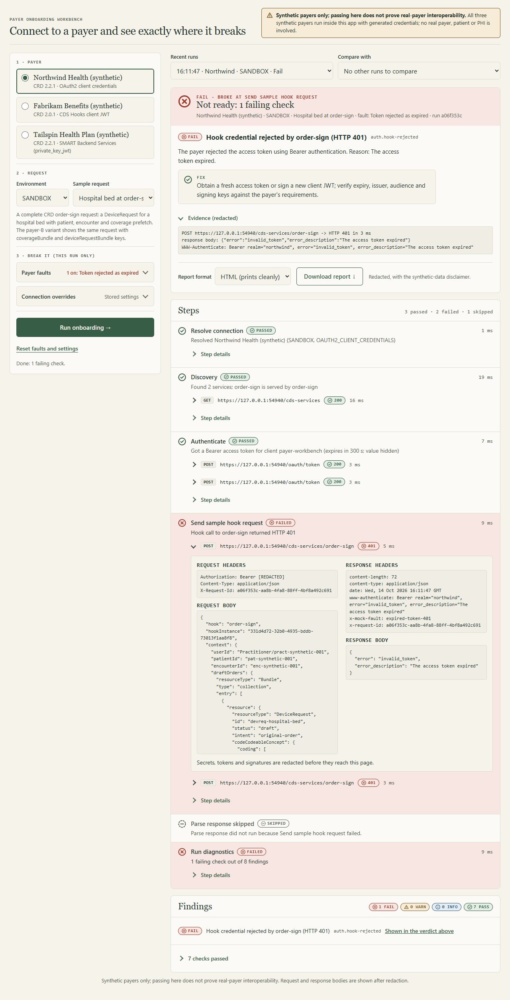
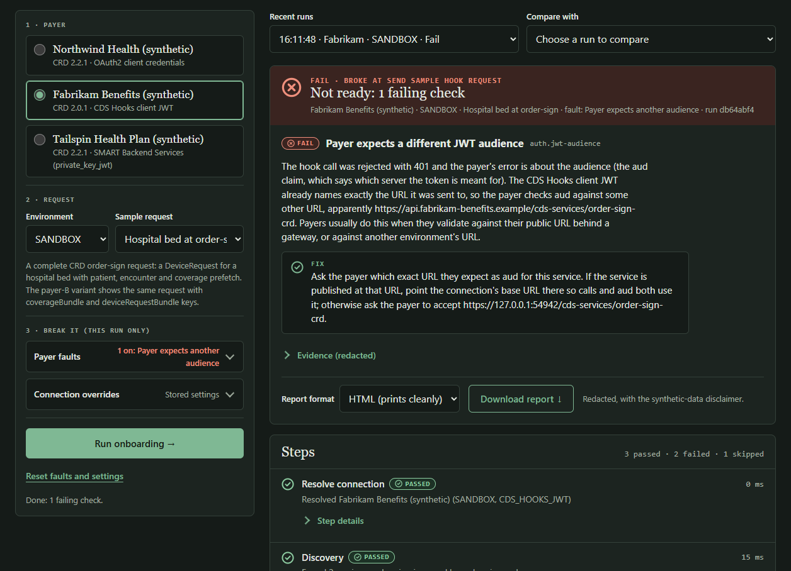

# Payer Onboarding Workbench

Connect to a (synthetic) insurance payer's FHIR CRD / CDS Hooks endpoint, inspect its discovery response, run sample requests, and get a plain-language diagnostic report when something goes wrong.

Built on [fhir-crd-router](https://github.com/dflippojr/fhir-crd-router), which stays independently usable; this workbench is an optional consumer of it.

**Status:** v1 is done. The onboarding flow (API and browser UI), the three mock payers, the diagnostic checks, the sample library, report export, the scripted demo and the replay bundle are merged, and the replay is live on [dflippojr.dev](https://dflippojr.dev/). Later work is tracked in [GitHub issues](https://github.com/dflippojr/payer-onboarding-workbench/issues).

All data is synthetic. No real payers, patients, or PHI. A passing run against the mock payers does not establish interoperability with any real payer. The one exception is [custom endpoints](#run-against-your-own-endpoint), off by default: a run still sends synthetic requests, but its report holds that endpoint's real responses.

## Develop

Requires JDK 21. Maven is not needed; use the wrapper.

fhir-crd-router is not on Maven Central yet, so install it into your local Maven repository first. The script clones the pinned commit into `.deps/` (gitignored) and runs its build:

```sh
./scripts/install-crd-router.sh        # macOS, Linux, Git Bash
```

```powershell
.\scripts\install-crd-router.ps1       # Windows PowerShell
```

Build and run the tests:

```sh
./mvnw verify
```

Run the app (serves on http://localhost:8080 by default, listening on loopback only because the API has no authentication; `--server.address` changes that). Install the sibling modules once, then run `workbench-app` on its own; adding `-am` to `spring-boot:run` fails on the parent pom, which has no main class:

```sh
./mvnw install -DskipTests
./mvnw -pl workbench-app spring-boot:run
./mvnw -pl workbench-app spring-boot:run -Dspring-boot.run.arguments=--server.port=9090   # another port
```

The five GitHub Actions workflows, the JaCoCo coverage floors, Dependabot and the SonarCloud Dependabot secret are in [docs/ci.md](docs/ci.md). `npm run ci:local` runs the same steps as `ci.yml`, and [AGENTS.md](AGENTS.md) says how to run each gate job on your machine.

Modules:

| Module | Purpose |
|--------|---------|
| `workbench-core` | Shared contracts and `Redactor`. Pure Java, no Spring. |
| `mock-payers` | Three embedded synthetic CDS Hooks payers. |
| `diagnostics` | Diagnostic checks and the engine that runs them. |
| `samples` | Synthetic request payloads. |
| `workbench-app` | Spring Boot app: REST API and static UI. |

Design decisions and how to override them: [DECISIONS.md](DECISIONS.md).

## UI interaction tests

Use the [UI testing contract](docs/ui-testing.md) for the disposable synthetic instance, device/theme journeys and cleanup. After building the jar with Maven, run `npm ci --ignore-scripts`, `node node_modules/@playwright/test/cli.js install chromium webkit`, `npm run test:ui-instance` and `npm run test:ui`. The browser tests run with one worker and start one fresh owned loopback instance per Playwright project; tests isolate themselves by their own run IDs, and a test that needs an untouched instance sets `freshInstance`. Start an exploratory instance with `node scripts/ui-instance.mjs start`; stop it with `node scripts/ui-instance.mjs stop`.

To check a change in the running app (launch, doctor, drive the main path, evidence, cleanup), use the [verify skill](.claude/skills/verify/SKILL.md): `npm run verify`.

## Onboarding flow

`workbench-app` walks you through connecting to a payer and shows exactly where it breaks. Start it and open http://localhost:8080:

```sh
./mvnw install -DskipTests                  # once, so the app's sibling modules are in your local repository
./mvnw -pl workbench-app spring-boot:run
```



On startup the app launches all three mock payers in-process on loopback ephemeral ports and seeds a `SANDBOX` `ConnectionRecord` for each in a directory-core `FileBasedConnectionStore` under a temp directory (owner-only where the file system supports POSIX permissions, and deleted on shutdown). Credentials (Northwind's client secret, Fabrikam's and Tailspin's separate RSA signing keys) are generated at startup and held only in memory; they are never written to disk, logged or returned by the API.

A run records these steps, each with its status, latency and redacted HTTP exchanges. The first failing step stops the run; the rest are marked skipped, and diagnostics run on whatever was observed.

1. **Resolve connection**: look up the record for the payer and environment, then apply any edits.
2. **Discovery**: `GET {baseUrl}/cds-services`, then find the service for the sample's hook.
3. **Authenticate**: an OAuth2 client-credentials token (Northwind), a signed CDS Hooks client JWT (Fabrikam), or SMART Backend Services `private_key_jwt` (Tailspin).
4. **Send the sample hook request**, with the prefetch keys the payer's discovery asks for.
5. **Parse the response** with the fhir-crd-router client types (cards, system actions, coverage information).
6. **Run diagnostics** (`DiagnosticEngine`, with the sample's hook as the required hook).

Discovery and hook calls go through the router's `CdsHooksClient`, which owns authentication, token caching, retries, timeouts and response parsing. Discovery uses an unauthenticated copy of the connection because all three synthetic payers advertise public discovery. The SDK's TOKEN and HOOK exchange events populate the separate Authenticate and Hook request steps; an OAuth2 401 shows both hook attempts and the token refresh. Diagnostics evaluate the final hook outcome once. For the JWT payer, a transport observer retains only the claims of the JWT the SDK actually sends. Token event bodies contain only `token_type`, `expires_in` and `scope`; token failures use the SDK's sanitized typed error metadata.

The UI is one page. On desktop the setup sits in a 380 px column beside the results, so **Run onboarding** and the answer share the first screen; below 960 px the two stack. The setup column has the payer picker, the environment and sample request, and two drawers for one run: **Payer faults** and **Connection overrides** (base URL suffix, `igVersion`, client id; never a secret). While closed, each drawer's summary says what is on ("1 on: Discovery is down", "Stored settings").

The results lead with the verdict. Before the first run they list the six steps a run walks. While a run is in flight they say what is running, with an indeterminate bar (static under reduced motion) and the six steps pending, and the previous run is hidden. When it ends, the verdict card gives Pass, or where the flow broke, with the first failing check's explanation, **Fix** and evidence, and the **Download report** control (HTML, Markdown or JSON). A compact step timeline follows: one row per step, with skipped steps folded into one row that names the cause, and each HTTP exchange on one line (method, path, status, ms) that opens into request and response side by side. Then come findings grouped by severity, with passing checks collapsed. Status is always an icon plus a word, never colour alone. Focus moves to the results heading when a run finishes.

The page follows `prefers-color-scheme`, has no horizontal scroll from 320 to 2560 px, keeps touch targets at least 44 px and is keyboard navigable. It is plain HTML, CSS and JS under `workbench-app/src/main/resources/static`, with no build step.

### API

| Method and path | Does |
|---|---|
| `GET /api/payers` | The synthetic payers, their stored connections (redacted), editable settings and fault ids. |
| `GET /api/features` | What this deployment allows (`customEndpoints`). |
| `GET /api/samples` | Sample request metadata. |
| `POST /api/runs` | Runs the steps and returns an `OnboardingRun`. Body: `payerId`, `environment` (default `SANDBOX`), `sampleId`, optional `faults` (fault ids), `slowResponseDelayMs`, and `connection` edits (`baseUrlSuffix`, `igVersion`, `clientId`). `baseUrlSuffix` can only add path segments, such as `/r4` or `/`: a suffix that doesn't start with `/`, has a `.` or `..` segment (raw or percent-encoded as `%2e` in either case, such as `/../admin` or `/%2E%2E`), or contains `@`, `?`, `#`, a backslash, whitespace or a control character is refused with 400 (audit reason `invalid_connection_edit`) and nothing is sent. Dots inside a segment, as in `/a.b`, are fine. A body that can't be bound, such as `[]`, `null`, an unknown `environment` or `"faults":[null]`, is refused with a 400 problem detail that names the field (`environment must be one of ...`, `faults must not contain null`) and never quotes the submitted value (audit reason `invalid_body`). `slowResponseDelayMs` must be between 0 and `request-timeout` plus 1 s (16000 by default); a negative or longer delay is refused with 400 before any run starts (audit reason `invalid_slow_response_delay`). Runs against one synthetic payer take turns, because its faults are shared: a run waits for the payer at most `request-timeout`, then is refused with 409 "another run against <payer> is in progress", and no run is started or remembered (audit reason `payer_busy`). With custom endpoints enabled, `customEndpoint` replaces `payerId` (see below). |
| `GET /api/runs` | Newest-saved-first summaries of retained runs: identifiers, first-step timestamp (null without steps), verdict and severity counts only. |
| `GET /api/runs/{id}` | A recent run (the last 200 are kept in memory). |
| `GET /api/runs/{id}/report?format=md\|html\|json` | A shareable diagnostic report of a recent run (default `html`). `400` for another format, `404` for an unknown run. |

Every request, to the API, `/actuator/**` and the UI alike, must name the workbench in `Host` as `localhost`, `127.0.0.1` or `[::1]` (any port, any case), or as the `--server.address` literal when that is a specific address rather than `0.0.0.0` or `::`. Anything else gets `403` with a problem detail naming `workbench.allowed-hosts`, before any other filter runs: nothing is started, stored or audited. Listening on loopback keeps other machines out but not a web page the user visits: with DNS rebinding the page's own name resolves to `127.0.0.1`, its same-origin requests reach the workbench with that name in `Host`, and the browser lets the page read the answers. If you deliberately serve the workbench under another name with `--server.address`, add it with `--workbench.allowed-hosts=name1,name2`. Each entry is a bare host name, an IPv4 address or an `[IPv6]` address, optionally with `:port` (ignored). A scheme, path, user info, wildcard or empty entry stops the workbench from starting, so `http://name` can't quietly allow the name `http`. An IPv6 address, in this setting or `--server.address`, is compared in the compressed form a browser sends (`2001:db8:0:0::5` matches `Host: [2001:db8::5]`). The single value `*` turns the check off and brings DNS rebinding back.

The live UI's **Recent runs** selector reloads history after a browser refresh and after each run. Reopening retrieves the existing timeline, findings and report without executing a run or changing form settings. History is process-local memory, bounded by `workbench.max-runs` (default 200), with the oldest insertion evicted first. A server restart clears all runs and reports; browser refresh does not.

Once a run is on screen, **Compare with** picks another retained run and shows a **Changes since run** section: tiles for the verdict and broke-at step before and after with a direction word, the steps whose status changed on one line, a **Checks that changed** table (newly failing or worse, fixed or better) with the unchanged checks named, and a collapsed **Only in one run** group. **Stop comparing** clears it. Checks are matched by `checkId` using each run's most severe finding. A check that only one run reported, such as checks skipped after a Discovery failure, is listed under **Only in one run** with the run that reported it and its result, and is never ranked as better, worse or unchanged. The comparison runs in the browser from two `GET /api/runs/{id}` reads, and is not part of reports or the replay viewer.

```sh
curl -s localhost:8080/api/runs -H 'Content-Type: application/json' \
  -d '{"payerId":"northwind-synthetic","sampleId":"order-sign-hospital-bed","faults":["expired-token-401"]}'
```

Faults apply to one run only; runs against the same payer are serialized so faults never leak between them.

### Run against your own endpoint

Off by default. The workbench otherwise only talks to its own synthetic payers; with custom endpoints on it forwards requests to a URL the caller supplies, so a deployed copy would be a request-forwarding service. Turn it on only for a copy you run yourself, on your own machine:

```sh
./mvnw -pl workbench-app spring-boot:run -Dspring-boot.run.arguments=--workbench.custom-endpoints.enabled=true
```

The UI then offers **Your own endpoint** in the payer picker, and `POST /api/runs` accepts `customEndpoint` instead of `payerId`. The run gets the same step timeline, findings and redacted report; its payer id is `custom-endpoint`. Connection edits (`baseUrlSuffix`, `igVersion`, `clientId`) apply to the supplied endpoint for this run only, overriding its values; blank edits keep the supplied values. The suffix uses the same path-only validation as synthetic runs: it cannot add user info, a query or a fragment, or leave the base URL's path with a `.` or `..` segment. Payer faults only apply to synthetic payers: the UI hides them for custom runs, and the API rejects custom requests with faults.

```sh
# The HL7 CRD reference server (bash scripts/crd-reference-server.sh start; CI's crd-reference job runs it):
curl -s localhost:8080/api/runs -H 'Content-Type: application/json' -d '{
  "sampleId": "order-sign-hospital-bed",
  "customEndpoint": {"baseUrl": "http://127.0.0.1:18090/r4", "authType": "NONE"}
}'
```

`customEndpoint` takes `baseUrl`, `authType` (`NONE`, `OAUTH2_CLIENT_CREDENTIALS`, `CDS_HOOKS_JWT` or `OAUTH2_PRIVATE_KEY_JWT` (SMART Backend Services)), `clientId`, `tokenEndpoint` (client credentials or SMART), `keyId` (CDS Hooks JWT or SMART), optional `igVersion` (default `2.0.1`) and `credential` (the client secret, or a PKCS#8 private key PEM).

A `customEndpoint` the workbench refuses (a missing `clientId`, `credential` or `keyId`, a `credential` with `NONE`, an unsupported `authType`, or `faults` on a custom run) gets 400 with audit reason `invalid_custom_endpoint`; a refused base URL or token endpoint gets `destination_rejected`. A custom run that passed those checks and then fails with a server error is audited `request_failed`, the same as a synthetic run.

With `authType: NONE` the hook call is sent without credentials and Authenticate passes as "No authentication configured", so a healthy payer that needs no auth, such as the reference server above, gets `PASS`. If the payer does want credentials, the run fails at Hook request and `auth.hook-rejected` says the request carried none.

For SMART Backend Services, supply all four authentication fields. The SDK chooses RS384 for RSA keys and ES384 for EC keys; register the matching public key with your local payer. This placeholder-only request illustrates the API shape (replace the placeholders before use):

```json
{
  "sampleId": "order-sign-hospital-bed",
  "customEndpoint": {
    "baseUrl": "http://127.0.0.1:18090",
    "authType": "OAUTH2_PRIVATE_KEY_JWT",
    "clientId": "<registered-client-id>",
    "tokenEndpoint": "http://127.0.0.1:18090/oauth/token",
    "keyId": "<registered-key-id>",
    "igVersion": "2.2.1",
    "credential": "<PKCS#8 private key PEM>"
  }
}
```

Keys stay in memory for one run, including rejected authentication. Reports show only the existing allowed assertion claims, never the signed assertion or signature. Custom endpoints remain disabled by default and intended only for your own local workbench.

- **Destinations.** `https` to public hosts, or `http` to `localhost`, `127.0.0.1` or `[::1]`. Private, loopback (for other hosts), link-local, unique-local, carrier-grade NAT and cloud-metadata addresses are refused with a message saying why, for the base URL and the token endpoint. A name that merely resolves to loopback doesn't get plain `http`. URLs with user info, a query or a fragment are refused, and redirects are never followed. Plain `http` to loopback is for a caller on this machine. A web page that rebinds its own name to `127.0.0.1` would turn it into a scanner of your loopback ports, so a request whose `Host` is not one of the workbench's own names is refused with `403` before any run starts (see [API](#api)).
- **DNS.** A host is resolved when the run starts and every request is checked against that answer; a changed answer aborts the call. The JDK HTTP client does its own lookup when it connects, so a rebind in that instant is narrowed, not impossible. That is another reason to keep this off on anything shared.
- **Credentials.** Accepted in the request body only, held in memory for that one run, then dropped. They are never stored, returned by `GET /api/runs/{id}`, logged, or put in a report; recorded exchanges go through `Redactor` as before, and so does whatever a payer echoes back into a card, an error or a finding (#211). That masking goes by pattern, not by value: an echo is masked when it keeps its scheme (`Bearer …`, `Basic …`, `Token …`, `DPoP …`), its secret-named field or form key, its PEM armor, or its place in a JWK. A payer that quotes the bare token or secret with none of these (`invalid token "…"`, `Bearer: …`) is not caught. `CustomEndpointTest` and `RunReportTest` plant a credential and look for it in the run, all three report formats, the log and the actuator endpoints.
- **Scope.** Passing against your own endpoint still only shows what the workbench observed in that run. Nothing is persisted, the replay bundle stays synthetic-only, and the workbench never retries, crawls or scans.

### Diagnostic reports

`GET /api/runs/{id}/report` turns a run into a report you can attach to a ticket or send to a payer. Every format covers the same ground: the verdict (`PASS`, `PASS_WITH_WARNINGS` or `FAIL`, and the step where the flow broke), the payer, environment and CRD IG version (expected by the connection and advertised by the payer), the run's correlation id (see [Observability](docs/observability.md#observability)), the step timeline with each HTTP exchange, findings by severity (most severe first) with explanation, redacted evidence and fix, when it was generated and by which workbench version, and the disclaimer. A run against a synthetic payer gets the synthetic-data / no-interoperability text. A custom-endpoint run says instead that it was made against a user-supplied endpoint with synthetic requests and that the report includes that endpoint's responses with credentials redacted, so read such a report before you share it.

- `html` is one self-contained file (inline CSS, no scripts or external assets). It opens with the verdict (icon and word, the step where the flow broke, counts by severity), then the facts with times in UTC to the second, the failing call, the timeline and the findings. The full ISO time stays in each `<time datetime>` attribute. On screen it uses the workbench's tokens and follows a dark preference. Print is always light, keeps headings with the block after them, keeps small blocks (facts, steps, Fix, the curl command, the footer) whole, and lets long bodies and findings flow across pages, so no page is left half blank.
- `md` is for pasting into an issue or a wiki.
- `json` is the same report as data, including each step's full (redacted) details and full ISO timestamps.

A `FAIL` report in `html` and `md` also has a **Failing call** section, between the verdict and facts and the timeline, so a payer engineer can see and reproduce the failure from the report alone. It shows one exchange: the last call of the step the flow broke at, or, when that step made no call or the flow completed and a check failed (`perf.latency`, `response.coverage-information`), the last hook request. There is no section when neither has a call, as with `connection.record`. The section gives the method, URL, status and latency, a `curl` command for the call (first in `html`), and the redacted request and response headers and bodies (JSON pretty-printed; each body capped at 16 KiB with a note that the JSON report has the full body, or its first 64 Ki characters as the run keeps them) or the transport error. In `html` the request and response sit side by side on screen and stack in print. The command keeps the non-secret request headers, drops credential headers, `Content-Length` and `Host`, sends `Authorization: Bearer <ACCESS_TOKEN>` (`<CLIENT_JWT>` for CDS Hooks JWT, `Basic <BASE64_CLIENT_ID_AND_SECRET>` for a Basic token request) where one was sent, reads the body shown above from `request.json` (`request-body.txt` for a non-JSON body) with `--data-binary`, and replaces anything the redactor masked with `<SECRET>`, so it never carries a credential or its redacted form. The `json` format is unchanged.

Redaction happens where data enters the run, and again when the report is built. Exchanges are redacted when they are recorded; a step's summary and details when the step is (`StepResult`); a finding's title, explanation, evidence and fix when it is created (`Finding`). In details and reports every string goes through `Redactor`, and any field named like a secret (`client_secret`, `access_token`, `Authorization`, `privateKey` and similar) is masked (`Redactor.redactTree`). String map keys are redacted too; arrays, `Optional`s and other collections are walked; a value of any other type, such as a parsed JSON tree, is kept only as its redacted string form. So `POST /api/runs`, `GET /api/runs/{id}` and the UI show what the reports show, even when a payer echoes the credentials it received into a card or an error. `Redactor` masks the same field names in recorded JSON bodies, including number, boolean, object and array values (a private JWK under `private_key` is masked whole) and JSON quoted inside a JSON string (also when that JSON is cut off before the string ends), and the private members of a JWK (`d`, `p`, `q`, `dp`, `dq`, `qi`, `oth` and `k`) in any JSON object with a `kty` member: a bare JWK, each key of a JWKS, also in JSON quoted inside a JSON string (a field named `d` in any other object is kept, except in malformed text that would take more than linear time to read, where every such name is masked). It masks a PEM block or PGP private key block, also one cut off before its footer, and a `Bearer`, `Basic`, `Token` or `DPoP` credential, URL-encoded or not (also after `Bearer%20` or `Bearer+`), through to the next whitespace, quote, comma, semicolon or backslash. The separator after the scheme may be a JSON escape of whitespace, read in place as the whitespace it stands for: after `Bearer` or `Basic` an escape of any whitespace Java's `\s` takes, `\t`, `\n`, `\f`, `\r`, `\u0020` or `\u0009` to `\u000D` in either case (also escaped again, `\\t`), after `Token` or `DPoP` only an escaped space or tab, as only a real space or tab separates them, so `{"echo":"Bearer\t<token>"}` is masked whole while `{"m":"Missing bearer\ntoken"}` stays prose. Inside the credential, a JSON escape of a token character counts as that character (`\/`, or `\u002B` and the other `\u` escapes of letters, digits and `-._~+/=`), so a token quoted by a serializer that escapes some of its characters (PHP escapes `/`, .NET's `System.Text.Json` escapes `+`) is masked whole. One short all-letter word after the scheme is kept as prose (`Missing bearer token`, `Basic authentication is required`, `Token expired`, also `token endpoint:` with its colon), unless it is a `Basic` token that decodes to a `user:pass` pair, with or without the period that ends a sentence. Anything longer is masked, so ordinary card text such as `Basic 80/20 plan` or `Basic Plan-A coverage` shows as `Basic [REDACTED] plan` in the live run and the reports alike; the rule errs toward masking. A form secret (`client_secret=...`) is masked through any backslash in it, stopping only at one that starts a JSON escape such as `\n` or `\"`. `RedactorPropertyTest` (jqwik) checks these rules as a class: it generates random tokens, Basic `user:pass` pairs, colon-split bearer tokens, numeric secrets and PEM private keys, raw or URL-encoded, places them in headers, bodies and query strings, with or without the text quoted inside a JSON string (also by a serializer that escapes `/` as `\/`, or `+` and `/` as `\u` escapes), puts a space, tab, line break, form feed or vertical tab, real or written as a JSON escape, between a scheme and its credential, and fails if any 8 characters of a secret survive, through `Redactor` and through every text field of `StepResult` and `Finding`, found by reflection. `replay/test/leaks.test.mjs` runs the same seeded generator against the replay leak scanner. The failing-call section is built from those redacted details and redacted once more after pretty-printing. `RunReportTest` plants a bearer token, a client secret, a JWT signature and a PEM private key in a run's step details, findings, and the failing exchange's request and response headers and bodies, and checks that none of them reach any format or the curl command.

```sh
curl -s "localhost:8080/api/runs/$RUN_ID/report?format=md" -o report.md
```



### What each fault and misconfiguration fails

`OnboardingFlowTest` reads this table and runs each row, on the payer it names or on all three when it names none. A run must fail exactly the listed `checkId`s and stop at the listed step. A note in parentheses describes the `checkId` before it.

| Fault or edit | Breaks at | FAIL `checkId` |
|---|---|---|
| none (healthy run) | nothing | none |
| `slow-response` | (steps pass; only the hook call is slow) | `perf.latency` |
| `expired-token-401` | hook request | `auth.hook-rejected` (payer expiry reason) |
| `rate-limited-429` | hook request | `perf.rate-limit` (`Retry-After: 30`, backoff advice) |
| `wrong-audience-reject`, Fabrikam | hook request | `auth.jwt-audience` |
| `wrong-audience-reject`, Northwind | hook request | `auth.hook-rejected` |
| `wrong-audience-reject`, Tailspin | authenticate | `auth.client-assertion` (expected and sent `aud`), `auth.token` |
| `coverage-info-incomplete` (all payers, `order-sign`) | diagnostics | `response.coverage-information` |
| `malformed-card` | parse response | `response.schema` |
| `discovery-500` | discovery | `discovery.reachable` |
| `prefetch-missing-400`, with sample `order-sign-missing-prefetch` | hook request | `response.schema` |
| `untrusted-certificate` | discovery | `tls.handshake` (untrusted CA), `discovery.reachable` |
| `expired-certificate` | discovery | `tls.handshake` (expired certificate), `discovery.reachable` |
| `hostname-mismatch` | discovery | `tls.handshake` (different host), `discovery.reachable` |
| base URL suffix `/r4` | discovery | `discovery.reachable` |
| `igVersion` `1.0.0` | (steps pass) | `ig.version` |
| wrong client id, Northwind | authenticate | `auth.token` |
| wrong client id, Tailspin | authenticate | `auth.token`, `auth.client-assertion` |
| wrong client id, Fabrikam | hook request | `auth.hook-rejected` |
| environment `PRODUCTION` (no record) | resolve connection | `connection.record` |

`response.coverage-information` validates every coverage-information extension in system actions and card suggestions using the router's Da Vinci CRD 2.2.1 validator. Evidence identifies the resource, extension location, and each violation's path and message. ERROR violations produce FAIL, WARNING violations produce WARN, and conformant content produces PASS. Healthy Northwind and Tailspin pass; healthy Fabrikam warns about its legacy `identifier` name without failing. With no coverage information, the check adds no finding.

Findings that come from the app rather than the diagnostics engine: `connection.record`, reported when no connection record exists, since nothing is sent, `run.response-too-large`, reported when a payer response ran past `workbench.max-response-bytes` or held more than `workbench.max-response-json-values`, and `run.too-many-cards`, reported when a hook response holds more than 1,000 cards. `Redactor` masks a bearer JWT whole in the recorded exchange, so for `auth.jwt-audience` the app records the non-secret claims of the CDS Hooks client JWT the SDK signs (`iss`, `aud`, `exp`, `iat`, `jti`, `kid`, never the token or its signature) with each hook call, and the engine compares `aud` with the service URL. When `aud` already is the service URL but the payer's 401 is about the audience, as with Fabrikam's `wrong-audience-reject`, the finding says the payer expects another URL and quotes the one it names. Tailspin records only `iss`, `sub`, `aud`, `exp`, `iat`, `jti`, and `kid` from the actual assertion signed by `JwtSigner.clientAssertion`; it never stores the assertion, encoded parts, signature or private key. `auth.client-assertion` passes when the token endpoint accepts it, and explains identity, audience, lifetime and replay rejections using the recorded claims and payer error description. Northwind checks the audience of its own access token, which the workbench cannot inspect, so `auth.hook-rejected` explains that 401 from the payer's `WWW-Authenticate` header and JSON error body. Fabrikam client-id rejections use the same check. It names the rejected credential, quotes the payer's reason, and recommends a fix for RFC 6750 `invalid_token`, `insufficient_scope` or `invalid_request`. Generic response-schema failures are suppressed for explained authentication and throttling errors. An expired credential alone is not clock skew; `auth.clock-skew` requires a measured difference or an explicit clock error.

Settings (`workbench.*` in `application.properties` or on the command line): `slow-response-delay` (default `11s`, past the 10 s budget), `latency-warn` (`5s`), `latency-fail` (`10s`), `request-timeout` (`15s`), `max-runs` (`200`), `max-response-bytes` (`4194304`, 4 MiB), `max-stored-run-bytes` (`33554432`, 32 MiB), `max-response-json-values` (`100000`), `max-concurrent-runs` (`4`). `request-timeout` and `max-runs` must be positive, and `slow-response-delay`, `latency-warn` and `latency-fail` must not be negative: the app refuses to start and names the setting when one is out of bounds, rather than failing each run later. `request-timeout` covers each whole payer call, body included: the JDK's own timeout stops once the response headers arrive, so a payer that sends headers and then stalls would otherwise hold the run for good. Past the timeout the call is cancelled, its partial body dropped, and the step fails as a call that got no response. The workbench stops reading any payer response body at `max-response-bytes`: the step fails with "the response exceeded the 4 MiB limit", the run records the status and headers, and the `run.response-too-large` finding names the limit. Bytes alone do not bound what parsing builds, since 4 MiB of `{}` is 1.4 million objects, so a body that arrived in full is also counted as a stream of JSON tokens before anything parses it. A body with more than `max-response-json-values` values (objects, arrays, strings, numbers, booleans and nulls) fails the same way: "the response holds more than 100000 JSON values", and the run keeps only its first 8 Ki characters. Within those limits, a step's details show at most 100 cards, coverage-information entries and discovered services, and at most 20 prefetch keys per service and `docNeeded` values per entry, followed by a count of the rest (`cardsNotShown`, `coverageInformationNotShown`, `servicesNotShown`, `prefetchKeysNotShown`, `docNeededNotShown`). A token response's `scope` keeps its first 20 scopes, and the `auth.token` evidence counts the rest ("and N more not shown"). Each payer-supplied string in a step's details or a token response (card summary, indicator and source label, service id, hook and prefetch key, coverage fields, `token_type`, each scope, `error` and `error_description`) is cut to 1,024 characters followed by `…`, each evidence line a check quotes to 1,024, and each text field of a finding to 8 Ki characters, so a few huge strings cannot make a large run. A selected service id longer than 1,024 characters fails discovery, since the workbench would have to put it in the hook URL. The parse summary names the first 5 cards that lack fields, a finding's evidence lists at most 20 problems, and a hook response with more than 1,000 cards fails the parse step without reading each card. The diagnostics read each body in full, up to those limits, but a remembered run keeps only the first 64 Ki characters of each request and response body, followed by `[kept the first 65536 of N characters]`. Past `max-stored-run-bytes` of remembered runs, measured as JSON, the oldest are forgotten even before there are `max-runs` of them; the newest is always kept. Together these bound the memory of one run however many runs `max-runs` keeps. A run in flight can still hold a few full bodies while it parses them, so at most `max-concurrent-runs` custom-endpoint runs run at once; one more is refused with HTTP 503, a `Retry-After: 5` header and a problem detail naming the setting, rather than queued. Runs against the synthetic payers are not counted: their responses are the workbench's own, and runs against one payer already take turns, each waiting at most `request-timeout` for its turn. The audit journal settings are listed under *Durable audit journal*.

## Audit review (offline)

Moved to [docs/audit.md](docs/audit.md#audit-review-offline).

### Durable audit journal (#69)

Moved to [docs/audit.md](docs/audit.md#durable-audit-journal-69).

### Fault changes and system operations

Moved to [docs/audit.md](docs/audit.md#fault-changes-and-system-operations).

## Observability

Moved to [docs/observability.md](docs/observability.md#observability).

## Demo

The scripted demo (`scripts/demo.mjs`), the replay embedded on [dflippojr.dev](https://dflippojr.dev/), and the published replay bundle are in [docs/replay.md](docs/replay.md).

## Embed on a website

Moved to [docs/replay.md](docs/replay.md#embed-on-a-website).

### The published bundle

Moved to [docs/replay.md](docs/replay.md#the-published-bundle).

## Mock payers

The three synthetic CDS Hooks payers in `mock-payers` (Northwind, Fabrikam and Tailspin) behave differently on purpose. Their start-up, fault injection, behaviour matrix and the sample requests are in [docs/mock-payers.md](docs/mock-payers.md).

### Start one standalone

Moved to [docs/mock-payers.md](docs/mock-payers.md#start-one-standalone).

### Fault injection

Moved to [docs/mock-payers.md](docs/mock-payers.md#fault-injection).

### Payer behaviours and the behaviour matrix

Moved to [docs/mock-payers.md](docs/mock-payers.md#payer-behaviours-and-the-behaviour-matrix).

## Sample requests

Moved to [docs/mock-payers.md](docs/mock-payers.md#sample-requests).

## License

MIT. See [LICENSE](LICENSE).
