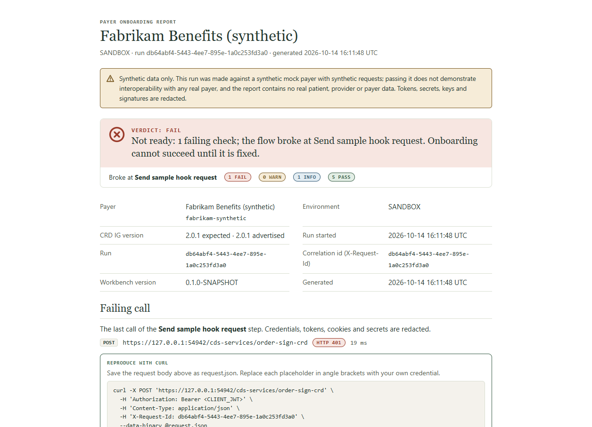
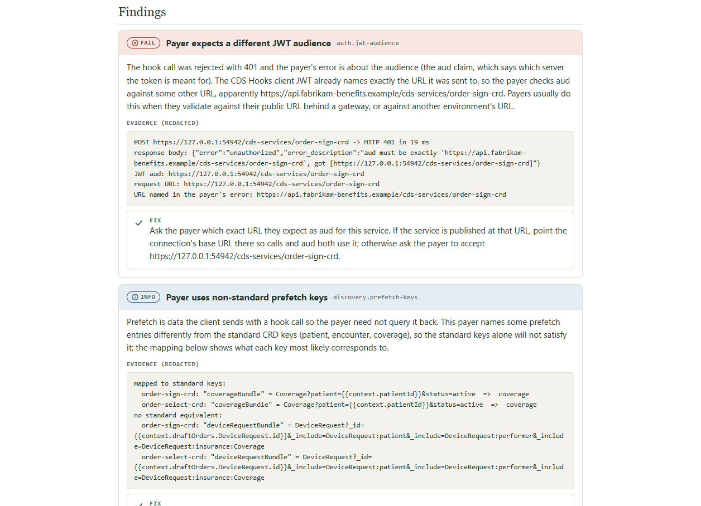
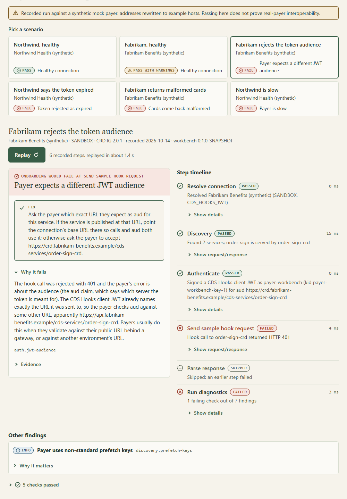

# Demo, embed and replay

## Demo

`node scripts/demo.mjs` (Node 22+ on all platforms) is a repeatable tour of the workbench through its REST API. It builds the app, starts it on a free port, makes four runs, writes each run's report to `demo-output/` (gitignored) as `.md`, `.html` and `.json`, and stops the app. It exits non-zero if any expected finding is missing, so CI runs it after `./mvnw verify`, and keeps `demo-output/` as a build artifact.

Cleanup stops only the Java child the script started. This policy also applies to replay export and interruption:

- **Linux and macOS:** the child gets `SIGTERM` and five seconds to exit, so JVM shutdown hooks can run. Then the script sends `SIGKILL` and waits at most five more seconds. A failed signal attempt escalates to `SIGKILL` immediately.
- **Windows:** Node maps both `SIGTERM` and `SIGKILL` to `TerminateProcess`, so the JVM ends at once, with no grace period, and its shutdown hooks do not run. If `java` on the `PATH` is a launcher shim (a parent process that starts the real JVM), terminating the shim can leave the JVM running and holding the port and `app.log`. Set `JAVA_HOME` so the scripts start `JAVA_HOME\bin\java.exe` directly; they print a warning when it is unset.
- **Interruption:** the first Ctrl+C prints `Stopping workbench PID n (Ctrl+C again to force)` and starts the stop above. A second Ctrl+C (or `SIGTERM`) sends `SIGKILL` at once, but the script still waits for the child to exit before it exits.

If exit cannot be observed, the script reports a cleanup failure and exits non-zero. Interruption exits 130 (`SIGINT`) or 143 (`SIGTERM`) after successful cleanup, or 1 after cleanup failure.

```sh
bash scripts/install-crd-router.sh   # once
node scripts/demo.mjs                # about a minute; DEMO_SKIP_BUILD=1 reuses an existing jar
```

It needs Node 22+ and JDK 21 (`JAVA_HOME` or `java` on the `PATH`). Set `DEMO_SKIP_BUILD=1` in your shell environment to reuse an existing jar.

| # | Run | What it shows | Expected findings |
|---|---|---|---|
| 1 | Northwind (OAuth2 client credentials), healthy | The whole flow passing: discovery, a client-credentials token, a hook call and parsed cards. | no `FAIL`; `PASS` `discovery.reachable`, `auth.token`, `response.schema` |
| 2 | Fabrikam (CDS Hooks client JWT), healthy | The same flow with a signed JWT instead of a token, and two `INFO` findings about Fabrikam's quirks: non-standard prefetch keys (mapped to the standard ones) and coverage information delivered in card suggestions. | no `FAIL`; `PASS` `discovery.reachable`, `ig.version`, `response.schema` |
| 3 | Fabrikam with `wrong-audience-reject` | The payer checks the JWT `aud` against a different URL and rejects the hook call with 401. The flow breaks at the hook request. The finding says the JWT already names the service URL, so the payer expects another one, and the evidence quotes the payer's error. | `FAIL` `auth.jwt-audience` |
| 4 | Northwind with `slow-response` | Every step passes and discovery and the token request answer quickly, but the hook call is held about 11 s, past the 10 s budget CDS Hooks clients tend to give up at. | `FAIL` `perf.latency` |

The reports for run 3, as HTML:





The screenshots in these docs come from `scripts/capture-screenshots.mjs`. It builds the app, runs the replay export below, starts the workbench on a free port, drives headless Edge or Chrome through the same runs, and overwrites `docs/screenshots/`. It fails if a run is missing the finding its screenshot shows, and it stops only the app and browser it started. Rerun it whenever the UI or the findings change.

```sh
node scripts/capture-screenshots.mjs   # about two minutes; CAPTURE_SKIP_BUILD=1 reuses the jar, CAPTURE_REUSE_REPLAYS=1 reuses site-dist/
```

It needs Node 22 or later, JDK 21 and Edge, Chrome or Chromium (`CAPTURE_BROWSER` to pick one). It has no npm dependencies.

## Embed on a website

The replay is embedded on the [dflippojr.dev](https://dflippojr.dev/) home page, served from `/workbench/`. A static site cannot host the Java app, so the workbench exports a replay bundle instead: real runs recorded against the synthetic payers, plus a small viewer with no framework and no dependencies. It works like `integration-failure-lab`'s `dist/`.

```sh
bash scripts/install-crd-router.sh                   # once
node scripts/export-replays.mjs                     # EXPORT_SKIP_BUILD=1 reuses the jar
node --test replay/test/bundle.test.mjs              # leak scan, manifest and rendering checks
node scripts/vendor-into-site.mjs ../personal-website/public/workbench
```

The export script builds the app, starts it on a free port, records six runs and writes `site-dist/` (gitignored). The slow-response run takes about 11 s. It exits non-zero if a run is missing an expected finding or if any `localhost` or `127.0.0.1` address is left in the bundle.

The mock payers listen on ephemeral `localhost` ports, so after redaction the export rewrites each recorded address to a stable example host: Northwind becomes `https://crd.northwind-health.example`, Fabrikam `https://crd.fabrikam-benefits.example`, Tailspin `https://crd.tailspin-health.example`, and the workbench's own JWKS `https://workbench.example`. The rewrite covers every field (step summaries, exchanges, headers, JWT claims, findings and evidence) so the story stays coherent: in the wrong-audience run the rewritten `aud` still differs from the `https://api.fabrikam-benefits.example` URL Fabrikam expects, by host only, as the finding explains. Only the exported JSON is rewritten; the live app and its reports keep the real addresses.

| File | What it is |
|---|---|
| `runs/<id>.json` | One run's report as `GET /api/runs/{id}/report?format=json` returns it (already redacted), with addresses rewritten to example hosts. Runs: `northwind-healthy`, `fabrikam-healthy`, `fabrikam-wrong-audience-reject`, `northwind-expired-token-401`, `fabrikam-malformed-card`, `northwind-slow-response`. |
| `manifest.json` | `workbenchVersion`, `gitCommit` (`-dirty` if tracked files had changes), `generatedAt`, and `runs`: `id`, `title`, `teaser` (the one line on the scenario card saying what breaks), `description`, `payerId`, `payerName`, `fault`, `verdict`, `file`. `teaser` and `payerName` are optional: without them the viewer uses the first FAIL finding's title and the report's payer name. |
| `replay.js` | ES module exporting `mountReplay(el, { baseUrl, run, headingLevel, autoplay })`, which resolves to `{ select(id), play(), showResult() }`. The only network calls are fetches of `manifest.json` and `runs/*.json` under `baseUrl`. |
| `shared/present.js` | The element builder, status icons and latency, header and JSON formatting that `replay.js` imports. It is the app's own `static/shared/present.js`, copied as-is. |
| `replay.css` | Styles, all scoped under `.pw-replay`. |
| `index.html` | A small test page that mounts the replay with `autoplay: true`. |

To try it locally: `python -m http.server --directory site-dist`, then open <http://localhost:8000/>. (Opening the file straight from disk does not work, because browsers block `fetch` from `file://`.)

On the site:

```html
<link rel="stylesheet" href="/workbench/replay.css">
<div id="workbench-replay"></div>
<script type="module">
  import { mountReplay } from '/workbench/replay.js';
  mountReplay(document.getElementById('workbench-replay'), {
    baseUrl: '/workbench/',          // where manifest.json lives; defaults to replay.js's folder
    run: 'fabrikam-wrong-audience-reject', // optional: the run shown first
    headingLevel: 2,                 // optional: level of the run title heading
    autoplay: false,                 // optional: play each run as soon as it is picked
  });
</script>
```

- **Picking a scenario.** The scenarios are cards in a radio group, so arrow keys move between them. Each card shows the title, the payer, and a verdict chip (icon and word) with a teaser of what breaks on its bottom line, so the chips in a row line up. Below 36rem of widget width a card shows just its title and verdict.
- **Playback.** **Run ▶** plays the recorded steps back one at a time; **Show result** skips to the end. Each step lasts `clamp(recorded ms × 0.25, 350 ms, 1200 ms)`, and if the steps add up to more than 6 s they are all shortened in proportion (`TIMING` in `replay.js`). The recorded milliseconds are always shown as text. A failed run stops at the step where the flow broke (the report's `brokeAt`, else the first failed step) and marks it with ✗ and "failed". The steps after it keep their recorded status, icon and word; only skipped steps are muted. On a slow-payer run (`perf.latency` WARN or FAIL), a bar on the slow step fills toward the budget (the 5 s warn and 10 s fail defaults, or the budget stated in the finding) and overshoots it, labelled with the real milliseconds. The run and its result are each announced once through an `aria-live` region. Under `prefers-reduced-motion: reduce`, Run shows the final state at once.
- **Result first.** When playback ends, a result card leads with the first FAIL finding: a band with an icon and "Onboarding would fail at …", the check's title, then the **Fix**, then the explanation in a **Why it fails** disclosure (open on desktop, folded at 600 px and narrower), with the check id, and "+N more failing checks" when there are several. From 48rem of widget width the result card and the timeline sit side by side. A run with no FAIL says "Onboarding would succeed" and names the steps it verified. WARN and INFO findings stay visible as one line each, with the explanation behind "Why it matters". Passing checks collapse to "N checks passed".
- **Raw HTTP.** Each step shows its title, status, latency and one-line summary. The redacted request and response headers and bodies sit behind one "Show request/response" disclosure per step (`<details>`, keyboard operable), and scrollable code blocks take focus.
- **Disclaimer.** Every view starts with "Recorded run against a synthetic mock payer; addresses rewritten to example hosts. Passing here does not prove real-payer interoperability." It is part of the mounted element and cannot be turned off.
- **Theming.** The colours come from the host page's custom properties when it defines them: `--paper`, `--ink`, `--green`, `--muted`, `--line`, `--accent`, `--warn`, plus an optional `--fail` (the same names as the lab's `lab.css`). Otherwise the workbench's own light and dark tokens apply, following `prefers-color-scheme`; tints the host does not define are mixed from its colours. To theme only the widget, set the `--pw-*` properties (`--pw-paper`, `--pw-ink`, `--pw-fail` and so on) on a selector more specific than `.pw-replay`. Text uses the page's font. Replay, Show result and every summary are at least 44 px tall, and the layout works at 320 px.
- **Safety.** The runs are synthetic, and every string was redacted twice before export: once when it was recorded, and again when the report was built. `replay/test/bundle.test.mjs` scans every bundle file for the patterns `Redactor` masks: PEM blocks, Bearer, Basic, Token and DPoP credentials, signed JWTs, private JWK members, secret fields in JSON and form bodies, and sensitive headers. It fails on any hit, and also on any file that is not part of the bundle. Point `REPLAY_BUNDLE_DIR` at a vendored copy to check that instead.
- **Vendoring.** `vendor-into-site.mjs` overwrites the bundle's files in the target and removes stale `runs/*.json`. It leaves everything else in the target alone. Re-export and re-vendor whenever the workbench changes, or vendor the published bundle (below).

### The published bundle

After every green `ci` run on a push to `main`, `.github/workflows/publish-replay-bundle.yml` publishes that run's `site-dist/` as assets of the rolling [`replay-bundle` pre-release](https://github.com/dflippojr/payer-onboarding-workbench/releases/tag/replay-bundle): `replay-bundle.tar.gz` (the whole bundle) and its `manifest.json`. Each publish replaces the last one and moves the tag to that commit. Before uploading, the workflow checks that the manifest's `gitCommit` is that clean `main` commit and runs the leak-scanner corpus and `replay/test/bundle.test.mjs` on the exact files it uploads. It checks out trusted `main` for the validators, never the triggering run's ref, and requires that run's commit to be an ancestor of `main`. A successful run can publish after another push advances `main`, even if the newer push's CI fails. It skips a bundle older than the one already published, so out-of-order completions cannot roll the release back.

Two modes of `vendor-into-site.mjs` use it. Both need only Node 22+ and `tar`, so the website repository can run a copy of the script without building this project:

```sh
node scripts/vendor-into-site.mjs --check ../personal-website/public/workbench
# stale by 187 commits: …/public/workbench has 9c386b11a911, the published bundle is 1a2b3c4d5e6f
node scripts/vendor-into-site.mjs --from-release ../personal-website/public/workbench
# Vendored 10 files from the published bundle (1a2b3c4d5e6f) into …/public/workbench
```

- **`--check`** compares the target's `manifest.json` `gitCommit` with the published one, counting commits through the GitHub compare API. It exits 0 when the copy is current (or newer), 1 when it is stale (`stale by N commits`, or `stale` when the copy names no clean commit), and 2 when it cannot tell: no manifest in the target, nothing published, or the API failed. A `-dirty` copy counts as its commit. Set `GITHUB_TOKEN` to lift the API's anonymous rate limit; it is sent to the API only.
- **`--from-release`** downloads `replay-bundle.tar.gz`, refuses it if an entry would land outside the bundle, contains links or other entries besides regular files and directories, or has no `manifest.json`, and vendors it exactly as the plain mode vendors `site-dist/`. It also checks the extracted tree for links before changing the target.

`WORKBENCH_RELEASE_URL` and `WORKBENCH_API_URL` point both modes at another release download and API base; `scripts/vendor-into-site.test.mjs` uses them with a local server.


